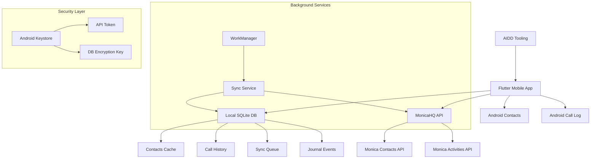
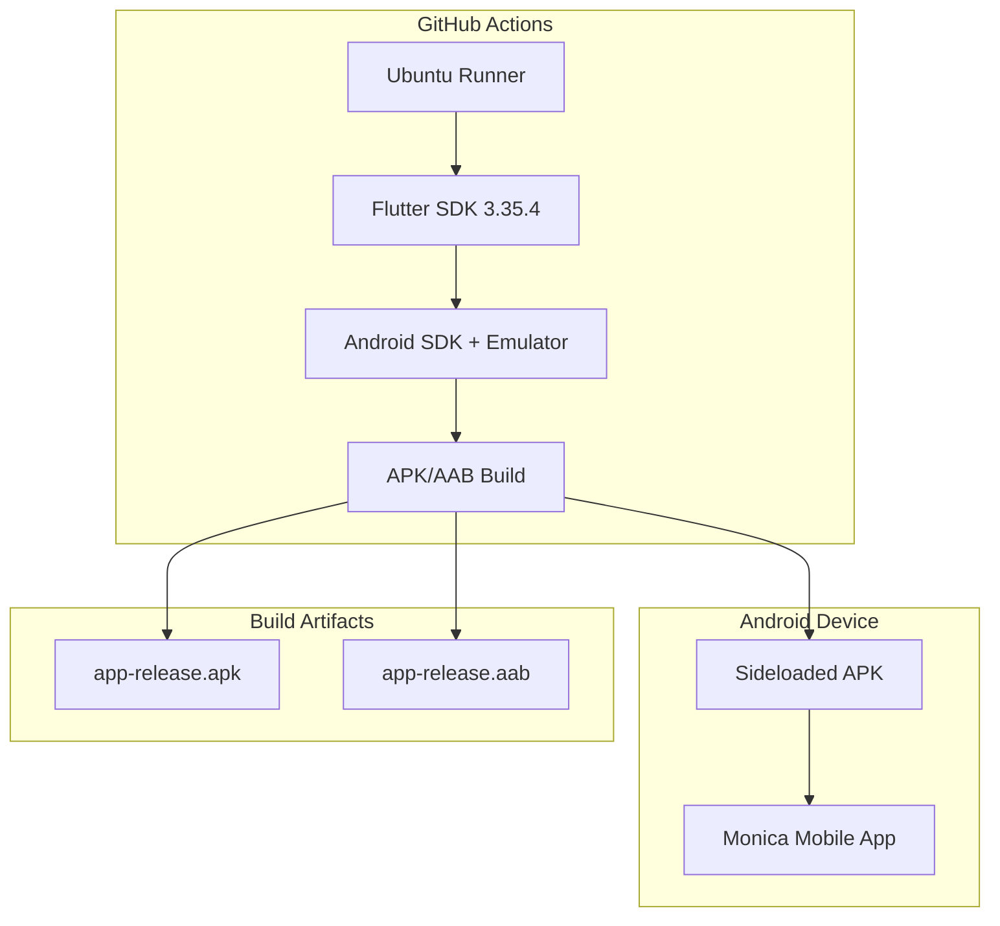
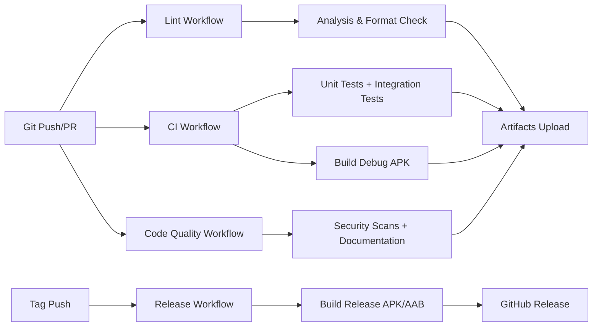
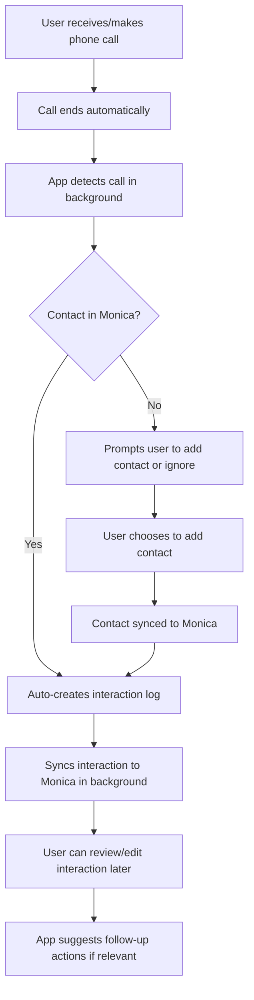
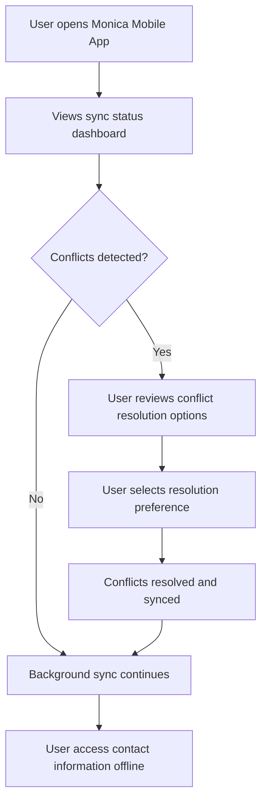
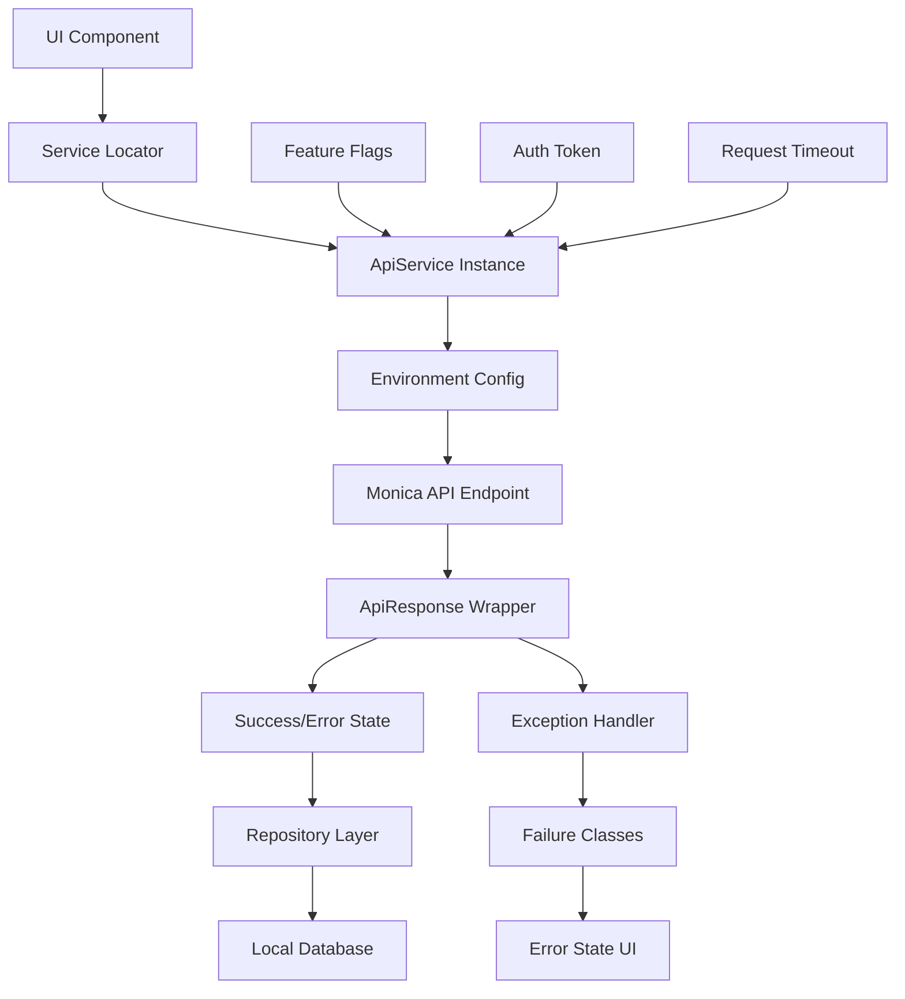
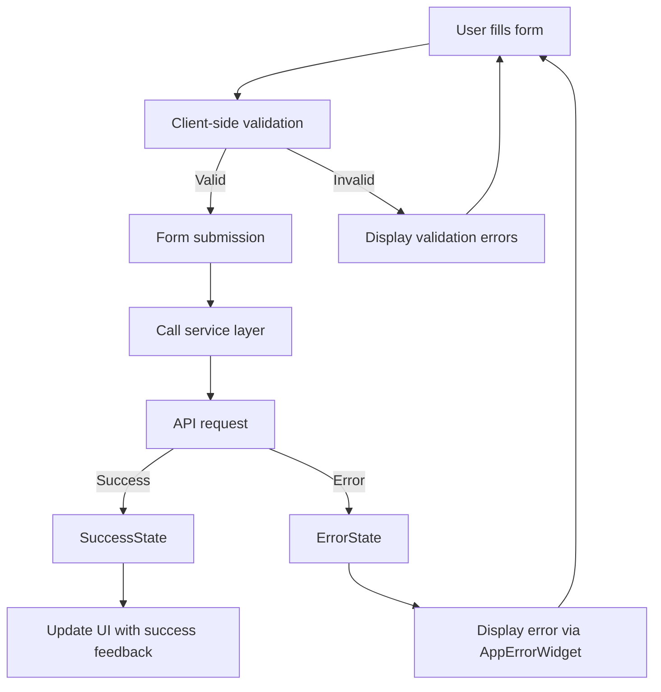
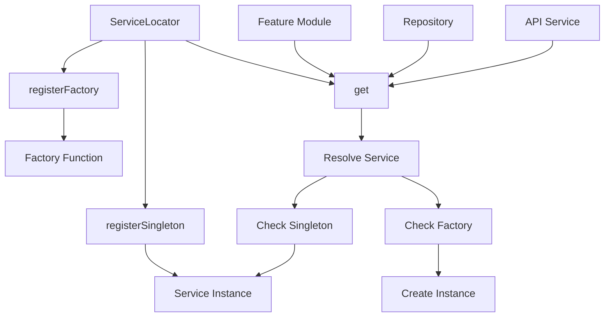
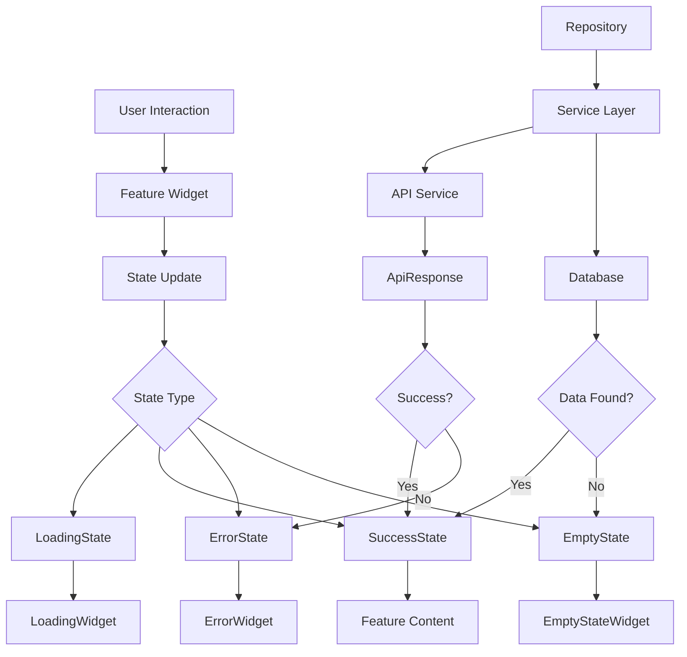
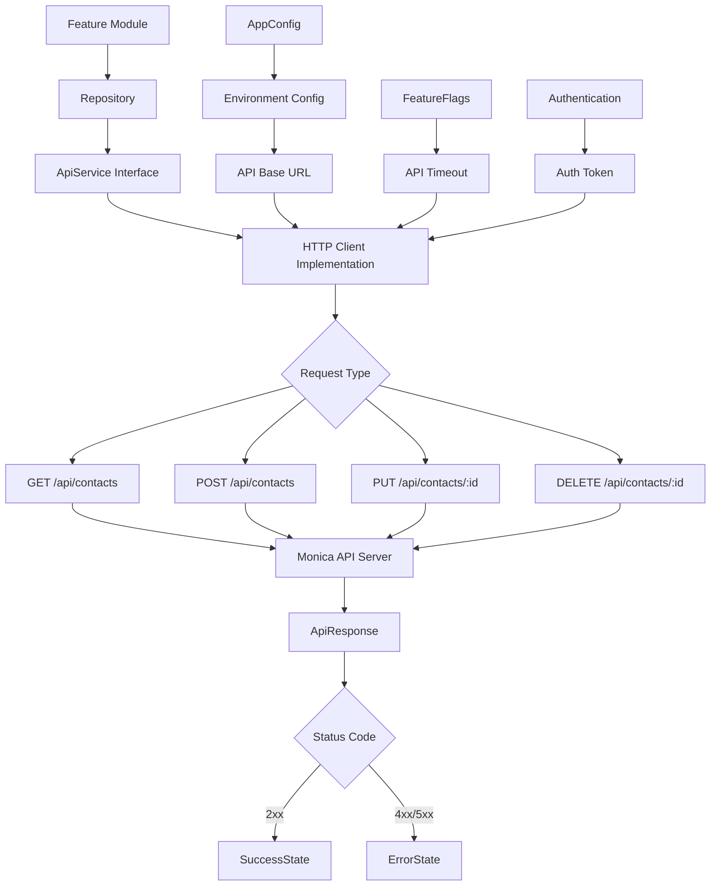

### Architecture

#### Frontend

- **Framework**: Flutter 3 → @pubspec.yaml - Material Design 3 with `useMaterial3: true`
- **Environment Config**: Custom flavor system with `Environment` enum - dev/staging/production
- **Feature Flags**: Environment-based feature toggles in `FeatureFlags` class
- **Validation**: Core validators with `Validators` class - email, phone, required field validation
- **Error Handling**: Custom exceptions with `AppException` and `Failure` classes
- **Logging**: Custom logger with environment-based console logging
- **Build Tool**: Flutter Build with Android flavors - dev flavor implemented
- **Structure**: Feature-First DDD pattern - features/*/domain|data|presentation layers

#### Backend

- **Language/Framework**: No Backend Service - Integrates with external MonicaHQ API
- **API Style**: REST Consumer - Consumes MonicaHQ REST API endpoints
- **Architecture**: Mobile-First - Logic embedded in Flutter application
- **Database**: Interface-based design with `DatabaseInterface` and `RepositoryInterface`
- **Models**: Base model pattern with `BaseModel` class for domain entities
- **Services**: Service locator pattern with interface-based dependency injection
- **Testing**: Flutter Test framework with unit tests and integration tests implemented

#### Mobile

- **Framework**: Flutter 3 (Dart) → @pubspec.yaml - SDK >=3.1.0
- **Platform**: Android with Gradle 8.9, AGP 8.6.0, Kotlin 2.1.0
- **Flavors**: Android product flavors - dev flavor with `.dev` suffix implemented
- **Icons**: Vector-based adaptive icons with XML launcher icons

#### Database

- **Architecture**: Interface-based with `DatabaseInterface` abstraction layer
- **Configuration**: `DatabaseConfig` class for connection management
- **Repositories**: Base repository pattern with `BaseRepository` implementation
- **Models**: Domain entities extend `BaseModel` with common fields
- **Testing**: Mock database services for unit testing

#### Authentication & Authorization

- **Services**: Interface-based with `StorageService` and `ApiService` abstractions
- **Authorization**: External MonicaHQ - Authorization handled by MonicaHQ instance
- **Base Services**: `BaseService` implementation with common service functionality

#### Core Patterns

- **Feature Architecture**: DDD-inspired pattern with domain/data/presentation layers
- **Repository Pattern**: Interface-based data access with `RepositoryInterface`
- **Service Locator**: Dependency injection with `ServiceLocator` class
- **Base Classes**: Common functionality with `BaseModel`, `BaseRepository`, `BaseService`
- **Error Handling**: Exception hierarchy with `AppException` and `Failure` classes
- **Feature State**: Shared state management with `FeatureState` model

#### Dependencies

- **Core**: `equatable: ^2.0.5` - Value equality for models
- **Development**: `flutter_lints: ^3.0.0` - Dart/Flutter linting rules
- **Testing**: `mocktail: ^1.0.0` - Mock generation for unit tests
- **Code Generation**: `json_serializable: ^6.7.1`, `build_runner: ^2.4.7` - JSON serialization
- **Integration Testing**: `integration_test` - End-to-end testing framework

#### Services communication



##### External Services

- **MonicaHQ API**: Primary data source and sync target
  - Authentication: Bearer token stored in Android Keystore
  - Rate limits: Respectful sync intervals with exponential backoff
  - Fallback strategy: Local queue with retry mechanism, offline mode support

- **Android System APIs**: Contact and call log access
  - Authentication: Runtime permissions (Contacts, Phone)
  - Rate limits: System-imposed, respectful polling intervals
  - Fallback strategy: Reduced mode without bidirectional sync if permissions denied

### CI/CD Implementation Guidelines

#### Version Management

##### Consistency Rules
- Use environment variables for all version specifications across CI jobs
- Pin Flutter/Dart versions in pubspec.yaml and reference in CI workflows
- Validate version consistency across all workflow jobs during implementation
- Never hardcode versions in individual job steps

##### Example Implementation
```yaml
env:
  JAVA_VERSION: "17"

jobs:
  lint:
    steps:
    - name: Setup Flutter
      uses: subosito/flutter-action@v2
      with:
        flutter-version-file: pubspec.yaml
```

#### Test Strategy

##### Test-Implementation Alignment
- Align test expectations with actual implementation behavior
- Fix tests when implementation is correct, not vice versa
- Validate test cases against business requirements before implementation
- Use descriptive test names that reflect actual behavior

##### Test Organization
- Separate unit tests from integration tests in CI jobs
- Run fast tests (lint, unit) before slow tests (integration, build)
- Provide clear failure messages and debugging information
- Use test randomization to catch order-dependent failures

##### Example Test Structure
```dart
group('isNotEmpty', () {
  test('should return true for non-empty strings', () {
    // Test actual implementation behavior, not assumptions
    expect(Validators.isNotEmpty('test with spaces'), isTrue);
  });
});
```

#### Build Configuration

##### Android Requirements
- Android minSdk should target reasonable compatibility (API 24+ recommended)
- Generate Android project files if missing via `flutter create --platforms android`
- Configure minSdkVersion explicitly in build.gradle.kts
- Support multiple environment branches (main, dev, staging)

##### Platform Support
- Document which platforms are currently supported (Android-only vs multi-platform)
- Use appropriate build commands for target platforms
- Handle platform-specific configuration in CI

##### Example Android Configuration
```kotlin
// android/app/build.gradle.kts
defaultConfig {
    minSdk = 24  // Android 7.0 for modern features
    targetSdk = flutter.targetSdkVersion
}
```

#### Job Dependencies

##### Pipeline Structure
- Structure jobs in logical order: lint → test → build → integration
- Use proper `needs` declarations for job sequencing
- Include all relevant jobs in final integration step
- Ensure proper failure propagation through dependency chain

##### Parallel Execution
- Run independent jobs in parallel for performance
- Group related checks in single jobs when beneficial
- Use job matrices for multi-platform builds
- Balance parallelism with resource constraints

##### Example Job Structure
```yaml
jobs:
  lint: # Fast feedback
  test: # Parallel with lint
  build:
    needs: [lint, test] # Only after quality gates
  integration:
    needs: [lint, test, build] # Final validation
```

#### Performance Optimization

##### Caching Strategy
- Cache Flutter SDK installations across jobs
- Cache Gradle dependencies for Android builds
- Cache pub dependencies between runs
- Use appropriate cache keys for invalidation

##### Timeout Management
- Set reasonable timeouts for each job type
- Allow longer timeouts for integration tests and builds
- Monitor actual execution times and adjust accordingly
- Fail fast on obvious errors

##### Artifact Management
- Upload build artifacts for debugging
- Set appropriate retention periods (7 days for debug builds)
- Compress large artifacts when possible
- Store coverage reports and test results

#### Error Handling

##### Failure Scenarios
- Handle missing dependencies gracefully
- Provide clear error messages for common failures
- Include troubleshooting information in CI output
- Use conditional execution to prevent cascading failures

##### Debug Information
- Log important configuration values
- Include version information in CI output
- Capture relevant logs for failed builds
- Provide links to relevant documentation

#### Environment Configuration

##### Branch Strategy
- Support development workflows with multiple branches
- Configure appropriate triggers for different branch types
- Use environment-specific configurations when needed
- Document branch protection rules and requirements

##### Secret Management
- Use GitHub secrets for sensitive configuration
- Avoid hardcoding credentials or tokens in workflows
- Document required secrets for project setup
- Use least-privilege access for CI tokens

#### Quality Gates

##### Code Quality Checks
- Enforce formatting consistency across all code
- Run static analysis with appropriate error levels
- Check for security vulnerabilities in dependencies
- Validate documentation and code comments

##### Test Coverage
- Monitor test coverage trends over time
- Set reasonable coverage thresholds (60%+ recommended)
- Generate coverage reports as artifacts
- Include coverage information in PR comments

##### Build Verification
- Verify builds complete successfully for target platforms
- Check build artifact sizes and warn on excessive growth
- Validate app startup and basic functionality
- Test deployment readiness for release builds

### Codebase Structure

#### Current State: Flutter Mobile App with AIDD Tooling

##### Flutter Naming Conventions (Implemented)

- **Files**: snake_case.dart (standard Dart convention)
- **Classes**: PascalCase (MonicaApp, HomePage, AppConfig, EnvironmentConfig)
- **Functions/Methods**: camelCase (build, main, runApp)
- **Variables**: camelCase (currentEnvironment, apiBaseUrl, allFlags)
- **Constants**: lowerCamelCase (AppConfig constants)
- **Configuration files**: snake_case.yaml, kebab-case.yml

##### Flutter Module Dependencies (Implemented)

- **Module Graph**: Core-first architecture with feature directories prepared
- **Circular Dependencies**: None - clean separation between core, features, and services
- **Import/Export Strategy**: Package imports for cross-module, relative imports within modules

##### Flutter Code Organization Principles (Implemented)

- **Separation of Concerns**: Core utilities separated from features and configuration
- **Feature-Based Structure**: Directory structure prepared for feature modules
- **Configuration Management**: Environment-aware configuration with flavor support

#### Implemented Directory Structure

```
/
├── .github/
│   └── workflows/
│       ├── ci.yml                   # CI pipeline with linting and tests
│       ├── code_quality.yml         # Code quality checks
│       ├── lint.yml                 # Linting workflow
│       └── release.yml              # Release workflow
├── android/
│   ├── app/
│   │   ├── src/
│   │   │   ├── main/                # Main Android configuration
│   │   │   ├── debug/               # Debug build configuration
│   │   │   ├── profile/             # Profile build configuration
│   │   │   └── release/             # Release build configuration
│   │   └── build.gradle             # Android build config with dev flavor
│   └── gradle/
│       └── wrapper/                 # Gradle wrapper
├── docs/
│   ├── FLAVORS.md                   # Flavor configuration documentation
│   └── LINTING.md                   # Linting setup documentation
├── integration_test/
│   ├── app_test.dart                # Main integration test suite
│   ├── helpers/                     # Test helper utilities
│   └── tests/                       # Additional integration tests
├── lib/
│   ├── main.dart                    # App entry point with Material 3 theme
│   ├── config/
│   │   └── feature_flags.dart       # Feature flag configuration
│   ├── core/                        # Core application utilities
│   │   ├── config/
│   │   │   ├── app_config.dart      # App configuration constants
│   │   │   └── environment.dart     # Environment detection and configuration
│   │   ├── constants/
│   │   │   └── app_constants.dart   # Application constants
│   │   ├── errors/
│   │   │   ├── exceptions.dart      # Custom exception definitions
│   │   │   └── failures.dart        # Failure types for error handling
│   │   └── utils/
│   │       ├── logger.dart          # Logging utilities
│   │       └── validators.dart      # Input validation utilities
│   ├── db/                          # Database layer (prepared structure)
│   │   ├── database_config.dart     # Database configuration
│   │   ├── interfaces/
│   │   │   ├── database_interface.dart
│   │   │   └── repository_interface.dart
│   │   ├── models/
│   │   │   └── base_model.dart      # Base model for data entities
│   │   └── repositories/
│   │       └── base_repository.dart # Base repository implementation
│   ├── features/                    # Feature modules (prepared structure)
│   │   ├── calls/                   # Call logging feature (directory prepared)
│   │   ├── contacts/                # Contact management feature (directory prepared)
│   │   ├── settings/                # Settings feature (directory prepared)
│   │   ├── shared/                  # Shared feature components
│   │   │   ├── models/
│   │   │   │   └── feature_state.dart
│   │   │   ├── utils/
│   │   │   │   └── feature_utils.dart
│   │   │   └── widgets/
│   │   │       ├── empty_state_widget.dart
│   │   │       ├── error_widget.dart
│   │   │       └── loading_widget.dart
│   │   └── sync/                    # Synchronization feature (directory prepared)
│   └── services/                    # Technical services (prepared structure)
│       ├── service_locator.dart     # Service locator for dependency injection
│       ├── implementations/         # Service implementations (directory prepared)
│       └── interfaces/              # Service interfaces (directory prepared)
├── scripts/
│   ├── setup-linting.sh             # Linting setup script
│   └── verify_config.md             # Configuration verification documentation
├── templates/                       # Project templates (directory prepared)
├── test/                            # Unit tests (mirroring lib structure)
│   ├── config/
│   ├── core/
│   │   ├── config/
│   │   ├── constants/
│   │   ├── errors/
│   │   └── utils/
│   ├── db/
│   │   ├── interfaces/
│   │   ├── models/
│   │   └── repositories/
│   ├── features/
│   │   └── shared/
│   │       ├── models/
│   │       ├── utils/
│   │       └── widgets/
│   ├── helpers/                     # Test helper utilities
│   ├── mocks/                       # Mock objects for testing
│   └── services/
│       ├── implementations/
│       └── interfaces/
├── aidd/                            # AIDD framework (symlink to shared tooling)
├── aidd-docs/                       # Project documentation and memory bank
│   ├── AGENTS.md                    # Main project specification
│   ├── flows/                       # Workflow documentation
│   ├── logs/                        # Process logs
│   ├── memory-bank/                 # Project memory bank files
│   ├── rules/                       # Project-specific rules
│   └── tasks/                       # Task documentation
├── aidd-generated/                  # Auto-generated files
├── .claude/                         # Claude AI project configuration
├── .github/                         # GitHub configuration
├── .dart_tool/                      # Dart tooling cache
├── .idea/                           # IntelliJ IDEA configuration
├── build/                           # Build outputs
├── .gitignore                       # Git ignore rules
├── .mcp.json                        # MCP configuration
├── analysis_options.yaml            # Dart/Flutter linting rules
├── lefthook.yml                     # Git hooks configuration
├── lefthook-local.yml               # Local git hooks override
├── pubspec.yaml                     # Flutter dependencies and configuration
├── pubspec.lock                     # Locked dependency versions
├── Makefile                         # Build automation
├── README.md                        # Project README
├── PRIVACY.md                       # Privacy policy
├── SECURITY.md                      # Security documentation
├── LICENSE                          # License file
├── CODE_OF_CONDUCT.md               # Code of conduct
└── CLAUDE.md                        # Symlink to project specification
```

#### Android Flavor Configuration (Implemented)

The Android build system includes flavor support:

- **Flavor Dimensions**: "environment" dimension configured
- **Implemented Flavors**: 
  - `dev`: Development flavor with .dev suffix and dev API URL
- **Prepared Flavors**: 
  - `staging`: Commented out, ready for staging environment
  - `prod`: Commented out, ready for production environment
- **Build Types**: debug, profile, release with appropriate configurations

#### Core Application Features (Implemented)

##### Environment Configuration System
- **EnvironmentConfig**: Detects current environment (development/staging/production)
- **AppConfig**: Centralized app configuration with flavor-aware settings
- **Feature Flags**: Centralized feature flag management system

##### Material 3 UI Framework
- **Theme System**: Material 3 with dynamic color schemes
- **Component Structure**: Shared widgets for loading, error, and empty states

##### Development Infrastructure
- **Linting**: Comprehensive linting rules with analysis_options.yaml
- **Testing**: Unit test structure mirroring lib/ directory
- **Integration Tests**: Full app integration testing setup
- **CI/CD**: GitHub Actions workflows for quality, linting, and release

#### File Naming Patterns (Implemented)

##### Dart Files
- **Application Files**: snake_case.dart (main.dart, app_config.dart)
- **Widget Files**: snake_case.dart with descriptive suffixes (_widget.dart, _page.dart)
- **Configuration Files**: snake_case.dart for config modules
- **Test Files**: {feature}_test.dart pattern

##### Configuration Files
- **Flutter Config**: snake_case.yaml (pubspec.yaml, analysis_options.yaml)
- **Build Config**: platform standards (build.gradle, lefthook.yml)
- **Documentation**: UPPER_CASE.md for major docs, kebab-case.md for specific docs

##### Asset Files (Prepared)
- **Images**: kebab-case naming in assets/images/
- **Icons**: kebab-case naming in assets/icons/

#### Import/Export Patterns (Implemented)

##### Dart Import Strategy
- **Cross-Module Imports**: package:monica_mobile_app/module/file.dart
- **Intra-Module Imports**: Relative paths (./file.dart, ../file.dart)
- **External Dependencies**: Standard package: imports from pubspec.yaml
- **Core Utilities**: Imported via package paths for consistency

##### Dependency Management
- **Dependencies**: Minimal core dependencies (equatable, cupertino_icons)
- **Dev Dependencies**: Comprehensive testing and development tools
- **Build Tools**: Code generation tools prepared for future use

#### Current Implementation Status

##### Fully Implemented
- ✅ Flutter project structure with proper naming conventions
- ✅ Android flavor system with dev environment
- ✅ Core configuration and environment detection
- ✅ Material 3 UI framework setup
- ✅ Comprehensive linting and code quality setup
- ✅ Testing infrastructure (unit and integration)
- ✅ CI/CD workflows with GitHub Actions
- ✅ Feature flag system
- ✅ AIDD documentation tooling integration

##### Directory Structure Prepared
- 📁 Feature modules (contacts, calls, sync, settings)
- 📁 Database layer with interfaces and repositories
- 📁 Service layer with implementations and interfaces
- 📁 Complete test structure mirroring lib/

##### Ready for Implementation
- 🔧 Monica API integration
- 🔧 Contact management features
- 🔧 Call logging functionality
- 🔧 Data synchronization
- 🔧 Local database implementation
- 🔧 Additional flavors (staging, prod)

### Coding Guidelines

> Those rules must be minimal because they MUST be checked after EVERY CODE GENERATION.

#### Requirements to complete a feature

In order to complete a feature at its best, always check at the end of the implementation:

- [ ] Whole plan is implemented in code (no omissions)
- [ ] All technical rules are followed
- [ ] Pre-commit hooks pass (`lefthook run pre-commit`)
- [ ] Build is successful (`make build-debug`)
- [ ] All tests pass (unit + integration)

**A feature is really completed if ALL of the above are satisfied: if not, iterate to fix all until all are green.**

##### Stack specifics rules (Flutter/Dart)

- [ ] `dart analyze --fatal-warnings` passes with zero issues
- [ ] `dart format .` produces no changes (code already formatted)
- [ ] `flutter test` passes all unit tests
- [ ] `flutter build apk --debug` succeeds
- [ ] All Dart files follow strict analysis options:
  - [ ] No dynamic calls (`avoid_dynamic_calls`)
  - [ ] No implicit casts (`implicit-casts: false`)
  - [ ] No implicit dynamic (`implicit-dynamic: false`)
  - [ ] All types explicitly declared (`always_specify_types`)
  - [ ] Trailing commas required (`require_trailing_commas`)
- [ ] Feature-first directory structure maintained in `lib/features/`
- [ ] Test files mirror source structure in `test/`

##### Build system rules

- [ ] Android build configuration supports dev environment flavor
- [ ] Makefile commands execute without errors:
  - [ ] `make deps` (flutter pub get)
  - [ ] `make analyze` (dart analyze --fatal-warnings)
  - [ ] `make format` (dart format .)
  - [ ] `make test` (flutter test)
  - [ ] `make build-debug` (flutter build apk --debug)

##### Git workflow rules

- [ ] Pre-commit hooks configured and passing:
  - [ ] `dart format` auto-formats staged files
  - [ ] `dart analyze --fatal-warnings` blocks commits with issues
- [ ] All Dart files formatted before commit
- [ ] No build artifacts committed (excluded in .gitignore)

##### Project structure rules (MonicaHQ Mobile App)

- [ ] Feature-first organization maintained:
  - [ ] `lib/features/` contains feature modules
  - [ ] `lib/core/` contains shared utilities
  - [ ] `lib/services/` contains external service integrations
  - [ ] `test/` mirrors `lib/` structure
- [ ] Dependencies properly declared in `pubspec.yaml`
- [ ] Analysis options enforce project code style standards
- [ ] Environment configuration uses build flavors (dev/staging/prod)

##### CI/CD Code Quality

- [ ] Environment variables for version management prevent inconsistencies
- [ ] Test cases must validate actual implementation behavior
- [ ] Job dependencies ensure proper failure propagation
- [ ] Caching strategies improve pipeline performance
- [ ] Flutter/Dart versions consistent across all CI jobs
- [ ] Android minSdkVersion set to 24 (Android 7.0) minimum
- [ ] Build artifacts generated and stored with appropriate retention

### Deployment

#### CI/CD Pipeline

##### Flutter Mobile Deployment Flow

- **Steps**:

  1. **Preparation**: Cache Flutter SDK, dependencies, and analysis results
  2. **Quality Gates**: Lint, format checks, security scans, and unit tests
  3. **Integration Tests**: Android emulator tests with AVD caching
  4. **Build**: Generate debug/release APK and AAB artifacts
  5. **Release**: Create GitHub releases with downloadable binaries

- **Test Automation**:

  - Unit tests: Run on every push/PR with `flutter test --coverage`
  - Integration tests: Android emulator on API level 30 for PRs
  - E2E tests: Flutter integration tests in `@integration_test/`

- **Deployment Triggers**:
  - Manual deployments: Use `make build-release` locally
  - Automated deployments: Git tags `v*.*.*` trigger release workflow

#### Monitoring & Logging

- **Monitoring Tools**: GitHub Actions workflow monitoring

  - Application monitoring: Flutter test coverage reports
  - Infrastructure monitoring: CI job success/failure tracking
  - Performance monitoring: APK size verification (warns >100MB)

- **Logging**:

  - Log aggregation: GitHub Actions workflow logs
  - Log levels: Debug prints prohibited in production builds
  - Log retention: GitHub Actions logs kept for 90 days, artifacts 7 days

- **Alert Configuration**:
  - Critical alerts: Build failures, security scan issues
  - Warning alerts: Test coverage below 60%, APK size warnings
  - Alert channels: GitHub notifications and email

#### Deployment Process

- **Deployment Steps**:

  - No database migrations (mobile app only)
  - Release APK/AAB built automatically on tag push
  - Manual sideloading via downloaded APK
  - Future: F-Droid store distribution planned

- **Rollback Procedure**:

  1. **Identify**: Monitor GitHub release downloads and user reports
  2. **Rollback**: Remove problematic release, direct users to previous version
  3. **Verify**: Confirm previous APK still works, communicate via GitHub

### Infrastructure

#### Project Structure

```plaintext
MonicaMobileApp/
├── android/                 # Android-specific configurations
│   ├── app/build.gradle     # Build config, flavors (dev/staging/prod)
│   └── gradle.properties    # Android build properties
├── lib/                     # Flutter Dart source code
├── test/                    # Unit tests
├── integration_test/        # Integration tests
├── .github/workflows/       # CI/CD pipeline definitions
│   ├── release.yml         # Release builds on tags
│   ├── PR.yml             # PR validation with Android builds
│   └── push.yml           # Push validation (lint, test)
└── pubspec.yaml            # Flutter dependencies and metadata
```

#### Environment Variables

##### Environment Files

- No `.env` files used (mobile app architecture)
- Build-time configuration via `@android/app/build.gradle`
- Flutter compile-time constants in build commands

##### Required Environment Variables

**GitHub Actions:**
- `GITHUB_TOKEN`: For release creation and artifact uploads
- `JAVA_VERSION`: "17" for Android builds
- `FLUTTER_VERSION`: "3.35.4" for consistent builds
- `PUB_CACHE`: Dependency caching optimization

**Android Build Config:**
- `API_BASE_URL`: API endpoints per flavor (dev/staging/prod)
- `FLAVOR`: Build variant identifier
- `MIN_SDK_VERSION`: 24 (Android 7.0+)

#### URLs

- **Development**:

  - URL: Local device/emulator via `flutter run`
  - Purpose: Local development and debugging

- **Production**:
  - URL: GitHub Releases for APK/AAB downloads
  - SLA: Manual distribution, no uptime guarantees

#### Containerization



### Infrastructure

#### Project Structure

```plaintext
MonicaMobileApp/
├── .github/                         # CI/CD workflows
│   └── workflows/
│       ├── ci.yml                   # Complete test suite + APK builds
│       ├── code_quality.yml        # Security scans, documentation checks
│       ├── lint.yml                 # Code analysis and linting
│       └── release.yml              # GitHub releases with APK/AAB artifacts
├── android/                         # Android platform configuration
│   ├── app/
│   │   ├── src/
│   │   │   └── main/               # Main manifest & resources
│   │   └── build.gradle            # Multi-flavor build config (dev/staging/prod)
│   └── gradle/                     # Gradle wrapper configuration
├── lib/                           # Flutter application code
│   └── core/config/environment.dart # Environment configuration
├── test/                          # Unit tests with helpers and mocks
├── integration_test/              # Integration tests for Android emulator
├── lefthook.yml                   # Git hooks configuration
├── analysis_options.yaml         # Dart/Flutter linting rules
└── pubspec.yaml                  # Flutter dependencies and metadata
```

#### Environment Variables

##### Flutter Build Configuration

**Environment Variables (@lib/core/config/environment.dart):**
- `FLAVOR` - Build flavor: `development`, `staging`, `production` (default: `development`)
- `API_BASE_URL` - Override default API URLs per environment

**Android Build Flavors (@android/app/build.gradle):**
- **dev**: `com.monica.app.dev` with development API endpoints
- **staging**: `com.monica.app.staging` (commented out, ready to enable)
- **prod**: `com.monica.app` for production (commented out, ready to enable)

**CI/CD Environment Variables:**
- `GITHUB_TOKEN` - For GitHub releases and artifact uploads
- `CODECOV_TOKEN` - For test coverage reporting (optional)

#### URLs

- **Development Environment**:
  - Local Flutter development with hot reload (`flutter run`)
  - Default API endpoint: `https://dev-api.monica.com` (dev flavor)

- **Distribution Channels**:
  - **GitHub Releases**: Direct APK/AAB download from repository releases
  - **F-Droid**: Planned for future releases (infrastructure ready)

- **API Endpoints by Environment**:
  - **Development**: `https://dev-api.monica.com`
  - **Staging**: `https://staging-api.monica.com` (not yet active)
  - **Production**: `https://api.monica.com` (not yet active)

#### Development Environment

**Local Development Setup:**
- Flutter SDK 3.19.0 (stable channel)
- Dart SDK with strict analysis (@analysis_options.yaml)
- Android SDK for emulator and device testing
- Git hooks with Lefthook (@lefthook.yml)

**Development Tools:**
- VS Code with Flutter extensions (recommended)
- Android Studio support available
- Git pre-commit hooks for formatting and analysis
- Automated dependency updates on branch switches

#### Testing & Code Quality

- **Test Execution**:
  - Unit tests: `flutter test --coverage` → Feature-organized with helpers (@test/)
  - Integration tests: `flutter test integration_test/` → Android emulator testing with real database operations
  - Test helpers and mocks: @test/helpers/ and @test/mocks/
  - Coverage reporting: Codecov integration

- **Integration Test Guidelines**:
  - Real database operations: Integration tests must use actual database, never mocks
  - Widget selector specificity: Use descendant finders to avoid duplicate widget matches
  - Complete entity data: Entity models require complete field sets for database operations
  - Database interface completeness: Interfaces must include both `rawExecute` and `rawInsert` methods

- **Database Testing Synchronization**:
  - Method-specific mocking: Insert operations mock `rawInsert`, update/delete operations mock `rawExecute`
  - Interface evolution: Database interface changes require coordinated test mock updates
  - Mock verification alignment: Verification calls must match implementation method usage
  - Error prevention: Proper mock synchronization prevents `type 'Null' is not a subtype` errors

- **Code Quality Tools**:
  - Linter: `dart analyze --fatal-infos --fatal-warnings` → @analysis_options.yaml
  - Formatter: `dart format --set-exit-if-changed` → Enforced formatting
  - Git hooks: @lefthook.yml → Pre-commit format + analysis
  - Security scanning: Hardcoded secrets detection, debug print checks

- **Quality Gates (CI/CD)**:
  - Static analysis: No fatal errors, warnings acceptable for development
  - Version consistency across all CI jobs enforced
  - Test coverage: Automatic coverage reports to Codecov
  - Build verification: Debug APK builds on every push
  - Dependency auditing: Security vulnerability scans

#### CI/CD Pipeline



**GitHub Actions Workflows:**
- **Lint** (@.github/workflows/lint.yml): Code analysis, formatting, dependency checks
- **CI** (@.github/workflows/ci.yml): Complete test suite + APK builds with emulator
- **Code Quality** (@.github/workflows/code_quality.yml): Security scans, documentation validation
- **Release** (@.github/workflows/release.yml): Tag-triggered releases with APK/AAB artifacts

**Build Strategy:**
- Flutter 3.13.0 stable for all workflows (consistent with pubspec.yaml requirement)
- Android emulator testing with API level 30
- Debug builds on every push/PR
- Release builds only on version tags
- Artifact retention: 7 days for debug builds

**CI/CD Best Practices:**
- Always use environment variables for version management across jobs
- Ensure test cases align with actual implementation behavior
- Implement proper job dependency chains for reliable pipeline execution
- Use caching for Flutter SDK, dependencies, and build artifacts

**Android Configuration:**
- minSdkVersion: 24 (Android 7.0) for modern feature support
- Android directory can be regenerated via `flutter create` for CI compatibility
- Build configuration supports dev and production environments

#### Mobile App Distribution

**Current Channels:**
- **GitHub Releases**: Direct APK/AAB download from repository releases
- Built from tagged versions with automated release workflow

**Planned Channels:**
- **F-Droid**: Infrastructure ready, not yet submitted

**Release Process:**
- Tag-based releases (`v*.*.*` pattern)
- Automated APK and AAB generation
- GitHub release creation with download links
- Release assets: `monica-mobile-app-{version}.apk` and `.aab`

#### Application Monitoring

**Test Coverage Monitoring:**
- Automated test execution in CI/CD
- Coverage reports via Codecov integration
- Unit test organization by features with test helpers

**Build Monitoring:**
- Automated APK builds on every commit
- Integration test execution on Android emulator
- Artifact upload and retention for debugging

**Code Quality Monitoring:**
- Security vulnerability scanning via `dart pub audit`
- Dependency monitoring with `flutter pub outdated`
- Static analysis with strict linting rules

#### Project Configuration

**Build Configuration:**
- Multi-flavor Android builds (@android/app/build.gradle)
- Environment-specific configuration (@lib/core/config/environment.dart)
- Strict Dart analysis rules (@analysis_options.yaml)
- Git hooks for code quality (@lefthook.yml)

**Development Dependencies (@pubspec.yaml):**
- Flutter SDK ≥3.13.0, Dart SDK ≥3.1.0 (pinned in CI environment variables)
- Testing framework: flutter_test, integration_test, mocktail
- Code generation: json_serializable, build_runner
- Linting: flutter_lints with extensive custom rules

**Security & Quality:**
- Hardcoded secrets detection in CI/CD
- Debug print statement scanning
- Dependency vulnerability auditing
- Automated formatting enforcement

### PROJECT_BRIEF.md

Monica Mobile App is a mobile companion application for Monica, the open-source Personal Relationship Manager (PRM) that helps users document their lives and organize their interactions with family, friends, and personal relationships.

#### Executive Summary

- **Project Name**: Monica Mobile App
- **Vision**: To provide a seamless mobile experience for managing personal relationships on-the-go
- **Mission**: Building a native mobile application that enables users to maintain and nurture their personal relationships through comprehensive contact management, automatic interaction logging, and relationship insights from anywhere
- **Primary Platform**: Android (V1), with iOS planned for future releases

##### Full Description

The Monica Mobile App aims to bridge the gap between the comprehensive web-based Monica PRM and the need for mobile accessibility. While the existing Monica platform offers powerful relationship management features through web browsers, users have expressed the need for a dedicated mobile application that provides quick access to contact information, enables automatic call logging, and sends proactive reminders about important relationship milestones.

This mobile app serves as a companion to the main Monica platform, focusing on the most frequently used mobile features while maintaining full bidirectional synchronization with the user's Monica account. The app prioritizes privacy with offline-first design, encrypted local storage, and minimal permission requirements.

#### Context

The project addresses a significant gap in the personal relationship management ecosystem. Monica, as an established open-source PRM, has built a strong community of users who document their personal relationships, but currently lacks mobile accessibility beyond responsive web design.

##### Core Domain

Monica operates in the Personal Relationship Management (PRM) domain, which applies Customer Relationship Management (CRM) principles to personal relationships. The core focus is on helping individuals maintain meaningful connections with their personal network by providing tools to remember important details, track interactions, and manage relationship-related tasks.

##### Ubiquitous Language

| Term | Definition |
|------|------------|
| Contact | A person in the user's personal network (family, friend, acquaintance, colleague) |
| Interaction | Any form of communication or meeting with a contact (call, message, in-person meeting) |
| Reminder | Automated notifications about important dates, follow-up actions, or relationship maintenance |
| Gift | Presents given or received, tracked for future reference and relationship building |
| Activity | Shared experiences or events involving contacts |
| Debt | Money borrowed or lent between the user and contacts |
| Relationship | The defined connection between the user and a contact (family member, friend, colleague) |
| Life Event | Significant occasions in contacts' lives (birthdays, anniversaries, job changes) |
| Note | Private observations or information about contacts |
| Task | Relationship-related actions or follow-ups |
| **Sync** | Bidirectional data synchronization between mobile app and Monica web platform |
| **Offline Mode** | Local app functionality without internet connection |
| **Call Log** | Automatic capture and recording of phone call interactions |
| **Conflict Resolution** | Process for handling data conflicts during synchronization |
| **Exclusion List** | User-defined list of contacts or numbers to exclude from sync |
| **Local Storage** | Encrypted SQLite database on device for offline data access |
| **Background Sync** | Automatic data synchronization occurring without user interaction |
| **Undo Journal** | Activity log enabling reversal of user actions |

#### Core Use Cases

##### Primary V1 Features
- **Bidirectional Contact Sync** - Seamlessly synchronize Android contacts with MonicaHQ
- **Automatic Call Logging** - Capture phone interactions with known and unknown contacts automatically
- **Offline Contact Access** - Access essential contact information without internet connection
- **Privacy-Focused Management** - Encrypted local storage with fine-grained sync control
- **Conflict Resolution** - Smart handling of sync conflicts with manual review options
- **Undo System** - Reverse actions with comprehensive activity journal

##### Extended Mobile Use Cases
- Quick contact lookup and information access while on-the-go
- Real-time logging of interactions immediately after phone calls or meetings
- Receiving and managing reminders for important relationship events and follow-ups
- Adding notes and observations about contacts during or after interactions
- Tracking gifts given or received during social occasions
- Recording debts and financial interactions with personal contacts
- Setting and managing relationship-related tasks and commitments
- Viewing relationship history and interaction patterns
- Exclusion lists for selective synchronization control

#### User Journey maps

##### Personas

- **Busy Professional**: Someone with an extensive network who struggles to maintain personal relationships due to time constraints and needs automated tracking
- **Family-Oriented Individual**: A person who wants to strengthen family bonds by remembering important details and staying connected through consistent contact
- **Social Butterfly**: An extroverted individual with many acquaintances who wants to deepen relationships and avoid forgetting important details
- **Privacy-Conscious User**: Someone who values relationship management but requires full control over data sync and storage

##### Primary Mobile Journey: Automatic Call Logging (V1 Focus)



##### Secondary Mobile Journey: Manual Contact Sync



### Communication between backend and frontend

This part describe how the frontend communicates with backend services, including the services used, types of requests, and main entities involved.

#### Overview

When frontend component communicates with the backend, it typically does so through a series of services and API endpoints. This section outlines the key components involved in this communication process.

- **Services**:
  • ApiService interface @ `lib/services/interfaces/api_service.dart` - HTTP operations wrapper
  • BaseService abstract class @ `lib/services/interfaces/base_service.dart` - Service lifecycle management
  • ServiceLocator @ `lib/services/service_locator.dart` - Dependency injection container

- **Request Types**:
  • GET, POST, PUT, DELETE, PATCH via ApiService interface
  • ApiResponse<T> wrapper with statusCode and data
  • Authentication token management (setAuthToken/clearAuthToken)

- **Entities**:
  • BaseModel @ `lib/db/models/base_model.dart` - Entity base class
  • Repository pattern @ `lib/db/repositories/base_repository.dart` - Local data persistence
  • RepositoryInterface @ `lib/db/interfaces/repository_interface.dart` - CRUD operations contract

- **Data Flow**:
  • Environment-based API URLs @ `lib/core/config/environment.dart` (dev/staging/prod Monica endpoints)
  • Request timeout & retry configuration @ `lib/core/config/app_config.dart`
  • Feature flags control API behavior @ `lib/config/feature_flags.dart`

- **Error Handling**:
  • Exception hierarchy @ `lib/core/errors/exceptions.dart` (NetworkException, ServerException, AuthenticationException)
  • Failure classes @ `lib/core/errors/failures.dart` - Clean architecture error handling
  • FeatureState classes @ `lib/features/shared/models/feature_state.dart` (LoadingState, SuccessState, ErrorState)

- **Validation**:
  • ValidationException for input validation
  • Validators utility @ `lib/core/utils/validators.dart`
  • Request body validation before API calls

##### Data Flow

When a new entity is created on the frontend, the following flow is typically followed to reach backend:



### DESIGN.md

#### Design Implementation

- **Design System Approach**: Material Design 3 (Material You) implementation via Flutter's built-in theming
- **Styling Method**: Theme-based styling using ColorScheme.fromSeed with deep purple seed color

#### Design System Files

- **Theme Config**: lib/main.dart - Material 3 theme with ColorScheme.fromSeed
- **Design Components**: lib/features/shared/widgets/ - Reusable state widgets
- **Style Guidelines**: Following Material Design 3 specifications

#### Design System

- **Spacing Scale**: Standard Flutter spacing - 8px base unit (SizedBox(height: 8/16/24))
- **Border Radius**: Material 3 default rounded corners
- **Shadows**: Material 3 elevation system
- **Breakpoints**: Flutter responsive defaults

- **Color Palette**: Material 3 dynamic color system

  - Primary: Deep Purple (seed) - App branding, primary actions
  - Secondary: Generated from seed - Secondary actions, accents
  - Accent: Inverse Primary - App bars, highlighted elements
  - Gray: Outline/OnSurfaceVariant - Subdued text, borders, icons

- **Typography**: Material 3 typography scale
  - Primary Font: System default (Roboto on Android, SF Pro on iOS)
  - Secondary Font: None specified
  - Fallback: Platform defaults

#### Component Standards and Variantes

- **Button Variants**: FilledButton.icon - Primary actions with icons
- **Input States**: Standard Material states - Focus/Error handled by theme
- **Card Patterns**: Center-aligned content with 24px padding

#### Layout System

- **Grid System**: Column/Row flexbox layout - Responsive Flutter widgets
- **Container Widths**: Full width with EdgeInsets.all(16/24) - Content padding
- **Spacing Rules**: Consistent 8/16/24px spacing - SizedBox for vertical spacing

#### Accessibility

- **Color Contrast**: Material 3 contrast - Built-in WCAG compliance
- **Focus Management**: Flutter semantics - Automatic keyboard navigation
- **Screen Reader**: Material widgets - Built-in ARIA equivalent support

### Forms

This part describe how frontend forms are handled in the project, including libraries used, validation strategies, and state management.

#### State Management

- **Flutter built-in state management** - Using `StatefulWidget` and `setState()` for local form state
- **Local form state** - Each form manages its own state using Flutter's standard approaches
- **Form submissions handled via services** - Forms call service layer methods for API communication
- **No persistence** - Form data is not persisted locally, cleared on navigation/reset

#### Validation

- **Custom validation utilities** - `lib/core/utils/validators.dart` provides validation functions
- **Client-side validation strategies**:
  - `Validators.isValidEmail()` - Email format validation with regex
  - `Validators.isValidUrl()` - URL format validation for HTTP/HTTPS schemes
  - `Validators.isValidPhoneNumber()` - Basic phone number format validation
  - `Validators.isNotEmpty()` - Non-null and non-empty string validation
  - `Validators.isValidApiToken()` - API token format validation (min 10 chars)

#### Error handling

- **Consistent error display** - Using `AppErrorWidget` for standardized error presentation
- **State-based error handling** - `ErrorState` from `FeatureState` hierarchy manages error states
- **Integration test support** - `IntegrationTestHelpers.fillTextField()` for automated form testing

#### Form Flow

Form submission follows this pattern: User input → Local validation → Service layer → API call → State update → UI response



### Architecture

- [Language/Framework](#languageframework)
  - [Mobile](#mobile)
- [Full project structure](#full-project-structure)
  - [Naming Conventions](#naming-conventions)
- [Services communication](#services-communication)
  - [Dependency Injection Flow](#dependency-injection-flow)
  - [State Management Flow](#state-management-flow)
  - [External Services](#external-services)
    - [Monica API](#monica-api)

#### Language/Framework

##### Mobile

- **Framework**: Flutter → @pubspec.yaml
- **State Management**: Custom state classes with Equatable - Clean architecture pattern
- **Platform**: iOS/Android/Both - Material Design 3
- **Dependency Injection**: Custom ServiceLocator pattern - Singleton and factory registration
- **Error Handling**: Failure classes with typed errors - NetworkFailure, ServerFailure, DatabaseFailure
- **Configuration**: Environment-based config with feature flags
- **Database**: Abstract interface for local storage - Transaction support
- **HTTP Client**: Generic ApiService interface - REST API with ApiResponse wrapper
- **Testing**: flutter_test, integration_test, mocktail → @pubspec.yaml

#### Full project structure

Core Flutter project following clean architecture principles with feature-based organization.

```text
lib/
├── main.dart                           # App entry point
├── config/
│   └── feature_flags.dart             # Environment-based feature toggles
├── core/                              # Shared core functionality
│   ├── config/
│   │   ├── app_config.dart            # App-wide configuration
│   │   └── environment.dart           # Environment settings
│   ├── constants/
│   │   └── app_constants.dart         # App constants
│   ├── errors/
│   │   ├── exceptions.dart            # Exception classes
│   │   └── failures.dart              # Failure classes for error handling
│   └── utils/
│       ├── logger.dart                # Logging utility
│       └── validators.dart            # Input validation
├── features/                          # Feature modules
│   ├── calls/                         # Call management feature
│   ├── contacts/                      # Contact management feature
│   ├── settings/                      # App settings feature
│   ├── sync/                          # Data synchronization feature
│   └── shared/                        # Shared feature components
│       ├── models/
│       │   └── feature_state.dart     # Base state classes
│       ├── utils/
│       │   └── feature_utils.dart     # Shared utilities
│       └── widgets/                   # Reusable UI components
│           ├── empty_state_widget.dart
│           ├── error_widget.dart
│           └── loading_widget.dart
├── services/                          # Service layer
│   ├── interfaces/
│   │   ├── api_service.dart           # HTTP API interface
│   │   ├── base_service.dart          # Base service interface
│   │   └── storage_service.dart       # Local storage interface
│   ├── implementations/
│   │   └── base_service_impl.dart     # Base service implementation
│   └── service_locator.dart           # Dependency injection
└── db/                               # Database layer
    ├── interfaces/
    │   ├── database_interface.dart    # Database abstraction
    │   └── repository_interface.dart  # Repository pattern
    ├── models/
    │   └── base_model.dart           # Base model class
    └── repositories/
        └── base_repository.dart      # Base repository implementation
```

##### Naming Conventions

- **Files**: snake_case - following Dart conventions
- **Classes**: PascalCase - MonicaApp, FeatureState
- **Functions**: camelCase - build, buildConfigItem
- **Variables**: camelCase - apiBaseUrl, currentEnvironment
- **Constants**: camelCase/UPPER_CASE - AppConfig.appName, Environment.DEVELOPMENT
- **Interfaces**: PascalCase with Interface suffix - DatabaseInterface, ApiService

#### Services communication

Internal communication follows clean architecture with dependency injection and state management patterns.

##### Dependency Injection Flow



##### State Management Flow



##### External Services

External service integration through abstract interfaces with environment-specific configuration.

###### Monica API



### Coding Guidelines

> Those rules must be minimal because the MUST be checked after EVERY CODE GENERATION.

#### Requirements to complete a feature

**A feature is really completed if ALL of the above are satisfied: if not, iterate to fix all until all are green.**

#### Steps to follow

Here are all the commands that must be run after each feature implementation, in order:

```markdown
| Order | Command               | Description                  |
|-------|-----------------------|------------------------------|
| 1     | `dart format .`       | Format all Dart code        |
| 2     | `dart analyze --fatal-warnings` | Analyze code for issues |
| 3     | `flutter test`        | Run all unit tests           |
| 4     | `flutter build apk --debug` | Build debug APK        |
| 5     | `flutter clean`       | Clean build artifacts        |
```

#### Code Style Rules

##### File Naming
- Use `snake_case` for file names: `user_repository.dart`
- Use `PascalCase` for class names: `UserRepository`
- Private constructors use named constructor: `Logger._()`

##### Type Safety
- **ALWAYS** specify explicit types: `final String message = 'error';`
- Use strict analyzer settings with `strict-casts: true`
- No implicit casts or dynamic types allowed
- Constructor parameters must specify types: `const AppException(this.message, [this.code]);`

##### Error Handling
- Use custom exception hierarchy extending `AppException`
- Separate `Exception` classes for throwing and `Failure` classes for clean architecture
- Always provide error codes: `const NetworkException('Connection failed', 'NET_001')`
- Implement `Equatable` for failure classes with `props` getter

##### Widget Development
- All widgets must have `super.key` parameter: `const AppErrorWidget({super.key})`
- Use `const` constructors wherever possible
- Extract theme access: `final ThemeData theme = Theme.of(context);`
- Use spread operator for conditional widgets: `if (onRetry != null) ...<Widget>[]`

##### Code Organization
- Utility classes must be private constructor: `Validators._()`
- Static methods for utilities: `static bool isValidEmail(String email)`
- Group related functionality in single files
- Use absolute imports: `package:monica_mobile_app/core/config/app_config.dart`

##### Documentation
- Use `///` for public API documentation
- Document class purpose at the top
- Use descriptive variable names without redundant comments

##### Testing Standards
- Group tests logically: `group('Validators', () {})`
- Descriptive test names: `'should return true for valid email addresses'`
- Use `expect()` with clear matchers: `expect(result, isTrue)`
- Test both positive and negative cases

##### Linting Rules
- Enforce trailing commas: `require_trailing_commas`
- Single quotes for strings: `prefer_single_quotes`
- Expression function bodies: `prefer_expression_function_bodies`
- Const constructors: `prefer_const_constructors`
- No print statements: `avoid_print` - use Logger instead

##### Imports
- Always use package imports, never relative: `avoid_relative_lib_imports`
- Order imports: dart, flutter, packages, local
- Exclude generated files from analysis: `**/*.g.dart`, `**/*.freezed.dart`

##### Flutter-Specific
- Use `useMaterial3: true` for Material 3 design
- Access theme via `Theme.of(context)` not direct colors
- Use `FilledButton.icon()` for modern button styles
- Extract build methods for complex widgets: `Widget _buildConfigItem()`

### Testing Guidelines

This document outlines the testing strategies and guidelines for the Monica Mobile App Flutter project.

#### Test Coverage

- Target: 60% minimum coverage (enforced in CI)
- Coverage reports: Generated via `flutter test --coverage`
- CI uploads coverage artifacts for review

#### Tools and Frameworks

- **flutter_test**: Flutter's built-in testing framework for unit and widget tests
- **integration_test**: Flutter's integration testing package for end-to-end tests
- **mocktail**: Modern mocking framework for Dart
- **Android Emulator**: API level 30 for integration tests in CI

#### Testing Strategy

- **Test-driven approach**: Tests run on every push and PR
- **Automated CI/CD**: Full test suite execution in GitHub Actions
- **Types of tests implemented:**
  - **Unit Tests**: Core utilities, validators, services
  - **Widget Tests**: UI components and app startup
  - **Integration Tests**: Full app workflows with Android emulator
  - **Mocking**: Services and external dependencies

#### Test Execution Process

##### Local Development
```bash
### Run unit tests
flutter test

### Run tests with coverage
flutter test --coverage

### Run integration tests
flutter test integration_test/

### Run specific test file
flutter test test/core/utils/validators_test.dart
```

##### CI/CD Pipeline
- **Push workflow**: Runs unit tests, linting, and coverage (@.github/workflows/push.yml)
- **PR workflow**: Runs integration tests with Android emulator (@.github/workflows/PR.yml)
- **Caching**: Flutter SDK, dependencies, and analysis cache optimized
- **Parallel execution**: Tests run in separate jobs for faster feedback

#### Test Structure

```
test/
├── @test/widget_test.dart                 # Main app widget tests
├── @test/core/utils/validators_test.dart  # Utility function tests
├── @test/core/utils/logger_test.dart      # Logger functionality tests
├── @test/config/environment_test.dart     # Environment config tests
├── @test/helpers/test_helpers.dart        # Common test utilities
├── @test/mocks/mock_services.dart         # Mock implementations
└── @test/db/                              # Database layer tests

integration_test/
├── @integration_test/app_test.dart        # End-to-end app tests
├── @integration_test/helpers/             # Integration test utilities
└── @integration_test/tests/               # Additional integration tests
```

#### Mocking and Stubbing

- **mocktail framework**: Used for creating mocks of services and interfaces
- **Mock services**: @test/mocks/mock_services.dart contains MockApiService, MockDatabaseInterface, MockStorageService
- **Fallback registration**: @test/helpers/test_helpers.dart handles mocktail setup
- **Test data generation**: Helper methods for consistent test entity creation
- **Mock responses**: Structured MockApiResponse class for API testing

#### Key Testing Patterns

- **Group-based organization**: Tests grouped by functionality
- **Mock setup helpers**: Centralized mock configuration in TestHelpers
- **Widget testing**: WidgetTester utilities for UI component testing
- **Integration screenshots**: Automated screenshot capture during integration tests
- **Async testing**: Proper pump and settle handling for async operations