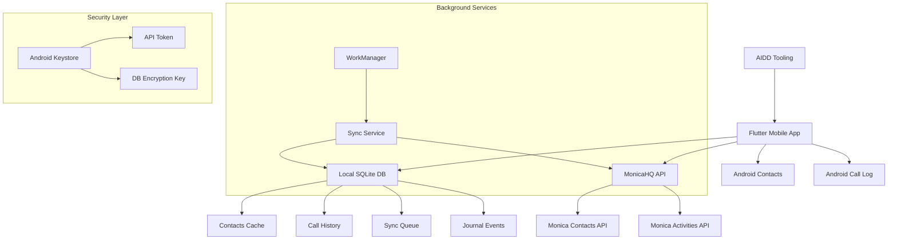

# Architecture

## Frontend

- **Framework**: Flutter 3 → @pubspec.yaml - Material Design 3 with `useMaterial3: true`
- **Environment Config**: Custom flavor system with `Environment` enum - dev/staging/production
- **Feature Flags**: Environment-based feature toggles in `FeatureFlags` class
- **Validation**: Core validators with `Validators` class - email, phone, required field validation
- **Error Handling**: Custom exceptions with `AppException` and `Failure` classes
- **Logging**: Custom logger with environment-based console logging
- **Build Tool**: Flutter Build with Android flavors - dev flavor implemented
- **Structure**: Feature-First DDD pattern - features/*/domain|data|presentation layers

## Backend

- **Language/Framework**: No Backend Service - Integrates with external MonicaHQ API
- **API Style**: REST Consumer - Consumes MonicaHQ REST API endpoints
- **Architecture**: Mobile-First - Logic embedded in Flutter application
- **Database**: Interface-based design with `DatabaseInterface` and `RepositoryInterface`
- **Models**: Base model pattern with `BaseModel` class for domain entities
- **Services**: Service locator pattern with interface-based dependency injection
- **Testing**: Flutter Test framework with unit tests and integration tests implemented

## Mobile

- **Framework**: Flutter 3 (Dart) → @pubspec.yaml - SDK >=3.1.0
- **Platform**: Android with Gradle 8.9, AGP 8.6.0, Kotlin 2.1.0
- **Flavors**: Android product flavors - dev flavor with `.dev` suffix implemented
- **Icons**: Vector-based adaptive icons with XML launcher icons

## Database

- **Architecture**: Interface-based with `DatabaseInterface` abstraction layer
- **Configuration**: `DatabaseConfig` class for connection management
- **Repositories**: Base repository pattern with `BaseRepository` implementation
- **Models**: Domain entities extend `BaseModel` with common fields
- **Testing**: Mock database services for unit testing

## Authentication & Authorization

- **Services**: Interface-based with `StorageService` and `ApiService` abstractions
- **Authorization**: External MonicaHQ - Authorization handled by MonicaHQ instance
- **Base Services**: `BaseService` implementation with common service functionality

## Core Patterns

- **Feature Architecture**: DDD-inspired pattern with domain/data/presentation layers
- **Repository Pattern**: Interface-based data access with `RepositoryInterface`
- **Service Locator**: Dependency injection with `ServiceLocator` class
- **Base Classes**: Common functionality with `BaseModel`, `BaseRepository`, `BaseService`
- **Error Handling**: Exception hierarchy with `AppException` and `Failure` classes
- **Feature State**: Shared state management with `FeatureState` model

## Dependencies

- **Core**: `equatable: ^2.0.5` - Value equality for models
- **Development**: `flutter_lints: ^3.0.0` - Dart/Flutter linting rules
- **Testing**: `mocktail: ^1.0.0` - Mock generation for unit tests
- **Code Generation**: `json_serializable: ^6.7.1`, `build_runner: ^2.4.7` - JSON serialization
- **Integration Testing**: `integration_test` - End-to-end testing framework

## Services communication

### External Services

- **MonicaHQ API**: Primary data source and sync target
  - Authentication: Bearer token stored in Android Keystore
  - Rate limits: Respectful sync intervals with exponential backoff
  - Fallback strategy: Local queue with retry mechanism, offline mode support

- **Android System APIs**: Contact and call log access
  - Authentication: Runtime permissions (Contacts, Phone)
  - Rate limits: System-imposed, respectful polling intervals
  - Fallback strategy: Reduced mode without bidirectional sync if permissions denied