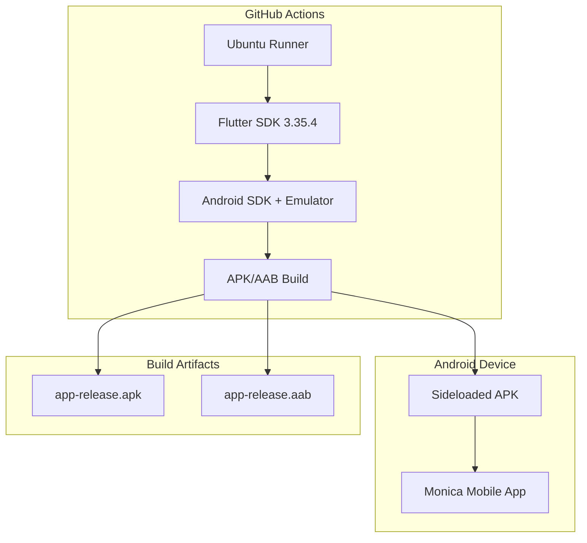

# Deployment

## CI/CD Pipeline

### Flutter Mobile Deployment Flow

- **Steps**:

  1. **Preparation**: Cache Flutter SDK, dependencies, and analysis results
  2. **Quality Gates**: Lint, format checks, security scans, and unit tests
  3. **Integration Tests**: Android emulator tests with AVD caching
  4. **Build**: Generate debug/release APK and AAB artifacts
  5. **Release**: Create GitHub releases with downloadable binaries

- **Test Automation**:

  - Unit tests: Run on every push/PR with `flutter test --coverage`
  - Integration tests: Android emulator on API level 30 for PRs
  - E2E tests: Flutter integration tests in `@integration_test/`

- **Deployment Triggers**:
  - Manual deployments: Use `make build-release` locally
  - Automated deployments: Git tags `v*.*.*` trigger release workflow

## Monitoring & Logging

- **Monitoring Tools**: GitHub Actions workflow monitoring

  - Application monitoring: Flutter test coverage reports
  - Infrastructure monitoring: CI job success/failure tracking
  - Performance monitoring: APK size verification (warns >100MB)

- **Logging**:

  - Log aggregation: GitHub Actions workflow logs
  - Log levels: Debug prints prohibited in production builds
  - Log retention: GitHub Actions logs kept for 90 days, artifacts 7 days

- **Alert Configuration**:
  - Critical alerts: Build failures, security scan issues
  - Warning alerts: Test coverage below 60%, APK size warnings
  - Alert channels: GitHub notifications and email

## Deployment Process

- **Deployment Steps**:

  - No database migrations (mobile app only)
  - Release APK/AAB built automatically on tag push
  - Manual sideloading via downloaded APK
  - Future: F-Droid store distribution planned

- **Rollback Procedure**:

  1. **Identify**: Monitor GitHub release downloads and user reports
  2. **Rollback**: Remove problematic release, direct users to previous version
  3. **Verify**: Confirm previous APK still works, communicate via GitHub

# Infrastructure

## Project Structure

```plaintext
MonicaMobileApp/
├── android/                 # Android-specific configurations
│   ├── app/build.gradle     # Build config, flavors (dev/staging/prod)
│   └── gradle.properties    # Android build properties
├── lib/                     # Flutter Dart source code
├── test/                    # Unit tests
├── integration_test/        # Integration tests
├── .github/workflows/       # CI/CD pipeline definitions
│   ├── release.yml         # Release builds on tags
│   ├── PR.yml             # PR validation with Android builds
│   └── push.yml           # Push validation (lint, test)
└── pubspec.yaml            # Flutter dependencies and metadata
```

## Environment Variables

### Environment Files

- No `.env` files used (mobile app architecture)
- Build-time configuration via `@android/app/build.gradle`
- Flutter compile-time constants in build commands

### Required Environment Variables

**GitHub Actions:**
- `GITHUB_TOKEN`: For release creation and artifact uploads
- `JAVA_VERSION`: "17" for Android builds
- `FLUTTER_VERSION`: "3.35.4" for consistent builds
- `PUB_CACHE`: Dependency caching optimization

**Android Build Config:**
- `API_BASE_URL`: API endpoints per flavor (dev/staging/prod)
- `FLAVOR`: Build variant identifier
- `MIN_SDK_VERSION`: 24 (Android 7.0+)

## URLs

- **Development**:

  - URL: Local device/emulator via `flutter run`
  - Purpose: Local development and debugging

- **Production**:
  - URL: GitHub Releases for APK/AAB downloads
  - SLA: Manual distribution, no uptime guarantees

## Containerization

