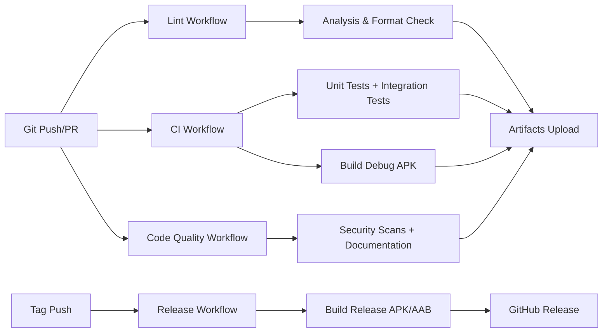

# Infrastructure

## Project Structure

```plaintext
MonicaMobileApp/
├── .github/                         # CI/CD workflows
│   └── workflows/
│       ├── ci.yml                   # Complete test suite + APK builds
│       ├── code_quality.yml        # Security scans, documentation checks
│       ├── lint.yml                 # Code analysis and linting
│       └── release.yml              # GitHub releases with APK/AAB artifacts
├── android/                         # Android platform configuration
│   ├── app/
│   │   ├── src/
│   │   │   └── main/               # Main manifest & resources
│   │   └── build.gradle            # Multi-flavor build config (dev/staging/prod)
│   └── gradle/                     # Gradle wrapper configuration
├── lib/                           # Flutter application code
│   └── core/config/environment.dart # Environment configuration
├── test/                          # Unit tests with helpers and mocks
├── integration_test/              # Integration tests for Android emulator
├── lefthook.yml                   # Git hooks configuration
├── analysis_options.yaml         # Dart/Flutter linting rules
└── pubspec.yaml                  # Flutter dependencies and metadata
```

## Environment Variables

### Flutter Build Configuration

**Environment Variables (@lib/core/config/environment.dart):**
- `FLAVOR` - Build flavor: `development`, `staging`, `production` (default: `development`)
- `API_BASE_URL` - Override default API URLs per environment

**Android Build Flavors (@android/app/build.gradle):**
- **dev**: `com.monica.app.dev` with development API endpoints
- **staging**: `com.monica.app.staging` (commented out, ready to enable)
- **prod**: `com.monica.app` for production (commented out, ready to enable)

**CI/CD Environment Variables:**
- `GITHUB_TOKEN` - For GitHub releases and artifact uploads
- `CODECOV_TOKEN` - For test coverage reporting (optional)

## URLs

- **Development Environment**:
  - Local Flutter development with hot reload (`flutter run`)
  - Default API endpoint: `https://dev-api.monica.com` (dev flavor)

- **Distribution Channels**:
  - **GitHub Releases**: Direct APK/AAB download from repository releases
  - **F-Droid**: Planned for future releases (infrastructure ready)

- **API Endpoints by Environment**:
  - **Development**: `https://dev-api.monica.com`
  - **Staging**: `https://staging-api.monica.com` (not yet active)
  - **Production**: `https://api.monica.com` (not yet active)

## Development Environment

**Local Development Setup:**
- Flutter SDK 3.19.0 (stable channel)
- Dart SDK with strict analysis (@analysis_options.yaml)
- Android SDK for emulator and device testing
- Git hooks with Lefthook (@lefthook.yml)

**Development Tools:**
- VS Code with Flutter extensions (recommended)
- Android Studio support available
- Git pre-commit hooks for formatting and analysis
- Automated dependency updates on branch switches

## Testing & Code Quality

- **Test Execution**:
  - Unit tests: `flutter test --coverage` → Feature-organized with helpers (@test/)
  - Integration tests: `flutter test integration_test/` → Android emulator testing
  - Test helpers and mocks: @test/helpers/ and @test/mocks/
  - Coverage reporting: Codecov integration

- **Code Quality Tools**:
  - Linter: `dart analyze --fatal-infos --fatal-warnings` → @analysis_options.yaml
  - Formatter: `dart format --set-exit-if-changed` → Enforced formatting
  - Git hooks: @lefthook.yml → Pre-commit format + analysis
  - Security scanning: Hardcoded secrets detection, debug print checks

- **Quality Gates (CI/CD)**:
  - Static analysis: No fatal errors, warnings acceptable for development
  - Version consistency across all CI jobs enforced
  - Test coverage: Automatic coverage reports to Codecov
  - Build verification: Debug APK builds on every push
  - Dependency auditing: Security vulnerability scans

## CI/CD Pipeline



**GitHub Actions Workflows:**
- **Lint** (@.github/workflows/lint.yml): Code analysis, formatting, dependency checks
- **CI** (@.github/workflows/ci.yml): Complete test suite + APK builds with emulator
- **Code Quality** (@.github/workflows/code_quality.yml): Security scans, documentation validation
- **Release** (@.github/workflows/release.yml): Tag-triggered releases with APK/AAB artifacts

**Build Strategy:**
- Flutter 3.13.0 stable for all workflows (consistent with pubspec.yaml requirement)
- Android emulator testing with API level 30
- Debug builds on every push/PR
- Release builds only on version tags
- Artifact retention: 7 days for debug builds

**CI/CD Best Practices:**
- Always use environment variables for version management across jobs
- Ensure test cases align with actual implementation behavior
- Implement proper job dependency chains for reliable pipeline execution
- Use caching for Flutter SDK, dependencies, and build artifacts

**Android Configuration:**
- minSdkVersion: 24 (Android 7.0) for modern feature support
- Android directory can be regenerated via `flutter create` for CI compatibility
- Build configuration supports dev and production environments

## Mobile App Distribution

**Current Channels:**
- **GitHub Releases**: Direct APK/AAB download from repository releases
- Built from tagged versions with automated release workflow

**Planned Channels:**
- **F-Droid**: Infrastructure ready, not yet submitted

**Release Process:**
- Tag-based releases (`v*.*.*` pattern)
- Automated APK and AAB generation
- GitHub release creation with download links
- Release assets: `monica-mobile-app-{version}.apk` and `.aab`

## Application Monitoring

**Test Coverage Monitoring:**
- Automated test execution in CI/CD
- Coverage reports via Codecov integration
- Unit test organization by features with test helpers

**Build Monitoring:**
- Automated APK builds on every commit
- Integration test execution on Android emulator
- Artifact upload and retention for debugging

**Code Quality Monitoring:**
- Security vulnerability scanning via `dart pub audit`
- Dependency monitoring with `flutter pub outdated`
- Static analysis with strict linting rules

## Project Configuration

**Build Configuration:**
- Multi-flavor Android builds (@android/app/build.gradle)
- Environment-specific configuration (@lib/core/config/environment.dart)
- Strict Dart analysis rules (@analysis_options.yaml)
- Git hooks for code quality (@lefthook.yml)

**Development Dependencies (@pubspec.yaml):**
- Flutter SDK ≥3.13.0, Dart SDK ≥3.1.0 (pinned in CI environment variables)
- Testing framework: flutter_test, integration_test, mocktail
- Code generation: json_serializable, build_runner
- Linting: flutter_lints with extensive custom rules

**Security & Quality:**
- Hardcoded secrets detection in CI/CD
- Debug print statement scanning
- Dependency vulnerability auditing
- Automated formatting enforcement