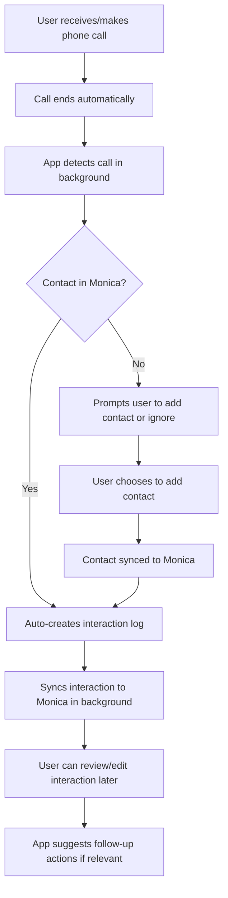
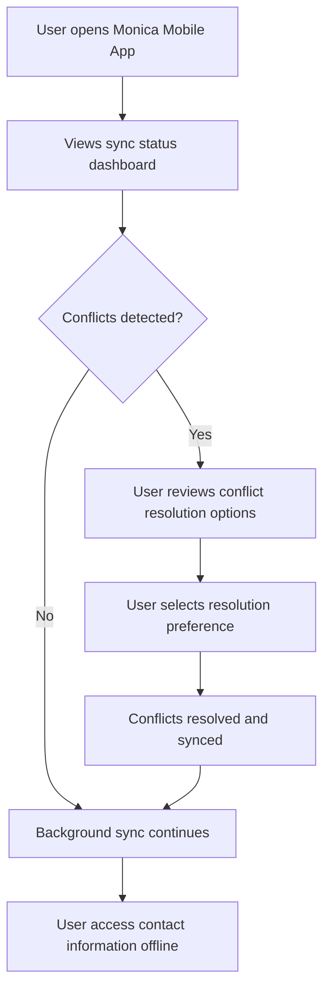

# PROJECT_BRIEF.md

Monica Mobile App is a mobile companion application for Monica, the open-source Personal Relationship Manager (PRM) that helps users document their lives and organize their interactions with family, friends, and personal relationships.

## Executive Summary

- **Project Name**: Monica Mobile App
- **Vision**: To provide a seamless mobile experience for managing personal relationships on-the-go
- **Mission**: Building a native mobile application that enables users to maintain and nurture their personal relationships through comprehensive contact management, automatic interaction logging, and relationship insights from anywhere
- **Primary Platform**: Android (V1), with iOS planned for future releases

### Full Description

The Monica Mobile App aims to bridge the gap between the comprehensive web-based Monica PRM and the need for mobile accessibility. While the existing Monica platform offers powerful relationship management features through web browsers, users have expressed the need for a dedicated mobile application that provides quick access to contact information, enables automatic call logging, and sends proactive reminders about important relationship milestones.

This mobile app serves as a companion to the main Monica platform, focusing on the most frequently used mobile features while maintaining full bidirectional synchronization with the user's Monica account. The app prioritizes privacy with offline-first design, encrypted local storage, and minimal permission requirements.

## Context

The project addresses a significant gap in the personal relationship management ecosystem. Monica, as an established open-source PRM, has built a strong community of users who document their personal relationships, but currently lacks mobile accessibility beyond responsive web design.

### Core Domain

Monica operates in the Personal Relationship Management (PRM) domain, which applies Customer Relationship Management (CRM) principles to personal relationships. The core focus is on helping individuals maintain meaningful connections with their personal network by providing tools to remember important details, track interactions, and manage relationship-related tasks.

### Ubiquitous Language

| Term | Definition |
|------|------------|
| Contact | A person in the user's personal network (family, friend, acquaintance, colleague) |
| Interaction | Any form of communication or meeting with a contact (call, message, in-person meeting) |
| Reminder | Automated notifications about important dates, follow-up actions, or relationship maintenance |
| Gift | Presents given or received, tracked for future reference and relationship building |
| Activity | Shared experiences or events involving contacts |
| Debt | Money borrowed or lent between the user and contacts |
| Relationship | The defined connection between the user and a contact (family member, friend, colleague) |
| Life Event | Significant occasions in contacts' lives (birthdays, anniversaries, job changes) |
| Note | Private observations or information about contacts |
| Task | Relationship-related actions or follow-ups |
| **Sync** | Bidirectional data synchronization between mobile app and Monica web platform |
| **Offline Mode** | Local app functionality without internet connection |
| **Call Log** | Automatic capture and recording of phone call interactions |
| **Conflict Resolution** | Process for handling data conflicts during synchronization |
| **Exclusion List** | User-defined list of contacts or numbers to exclude from sync |
| **Local Storage** | Encrypted SQLite database on device for offline data access |
| **Background Sync** | Automatic data synchronization occurring without user interaction |
| **Undo Journal** | Activity log enabling reversal of user actions |

## Core Use Cases

### Primary V1 Features
- **Bidirectional Contact Sync** - Seamlessly synchronize Android contacts with MonicaHQ
- **Automatic Call Logging** - Capture phone interactions with known and unknown contacts automatically
- **Offline Contact Access** - Access essential contact information without internet connection
- **Privacy-Focused Management** - Encrypted local storage with fine-grained sync control
- **Conflict Resolution** - Smart handling of sync conflicts with manual review options
- **Undo System** - Reverse actions with comprehensive activity journal

### Extended Mobile Use Cases
- Quick contact lookup and information access while on-the-go
- Real-time logging of interactions immediately after phone calls or meetings
- Receiving and managing reminders for important relationship events and follow-ups
- Adding notes and observations about contacts during or after interactions
- Tracking gifts given or received during social occasions
- Recording debts and financial interactions with personal contacts
- Setting and managing relationship-related tasks and commitments
- Viewing relationship history and interaction patterns
- Exclusion lists for selective synchronization control

## User Journey maps

### Personas

- **Busy Professional**: Someone with an extensive network who struggles to maintain personal relationships due to time constraints and needs automated tracking
- **Family-Oriented Individual**: A person who wants to strengthen family bonds by remembering important details and staying connected through consistent contact
- **Social Butterfly**: An extroverted individual with many acquaintances who wants to deepen relationships and avoid forgetting important details
- **Privacy-Conscious User**: Someone who values relationship management but requires full control over data sync and storage

### Primary Mobile Journey: Automatic Call Logging (V1 Focus)

### Secondary Mobile Journey: Manual Contact Sync

