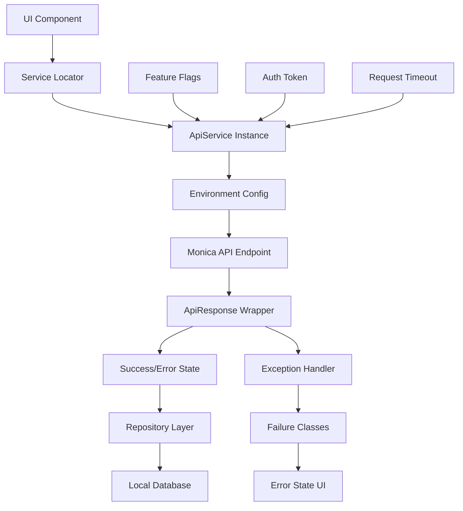

# Communication between backend and frontend

This part describe how the frontend communicates with backend services, including the services used, types of requests, and main entities involved.

## Overview

When frontend component communicates with the backend, it typically does so through a series of services and API endpoints. This section outlines the key components involved in this communication process.

- **Services**:
  • ApiService interface @ `lib/services/interfaces/api_service.dart` - HTTP operations wrapper
  • BaseService abstract class @ `lib/services/interfaces/base_service.dart` - Service lifecycle management
  • ServiceLocator @ `lib/services/service_locator.dart` - Dependency injection container

- **Request Types**:
  • GET, POST, PUT, DELETE, PATCH via ApiService interface
  • ApiResponse<T> wrapper with statusCode and data
  • Authentication token management (setAuthToken/clearAuthToken)

- **Entities**:
  • BaseModel @ `lib/db/models/base_model.dart` - Entity base class
  • Repository pattern @ `lib/db/repositories/base_repository.dart` - Local data persistence
  • RepositoryInterface @ `lib/db/interfaces/repository_interface.dart` - CRUD operations contract

- **Data Flow**:
  • Environment-based API URLs @ `lib/core/config/environment.dart` (dev/staging/prod Monica endpoints)
  • Request timeout & retry configuration @ `lib/core/config/app_config.dart`
  • Feature flags control API behavior @ `lib/config/feature_flags.dart`

- **Error Handling**:
  • Exception hierarchy @ `lib/core/errors/exceptions.dart` (NetworkException, ServerException, AuthenticationException)
  • Failure classes @ `lib/core/errors/failures.dart` - Clean architecture error handling
  • FeatureState classes @ `lib/features/shared/models/feature_state.dart` (LoadingState, SuccessState, ErrorState)

- **Validation**:
  • ValidationException for input validation
  • Validators utility @ `lib/core/utils/validators.dart`
  • Request body validation before API calls

### Data Flow

When a new entity is created on the frontend, the following flow is typically followed to reach backend:

