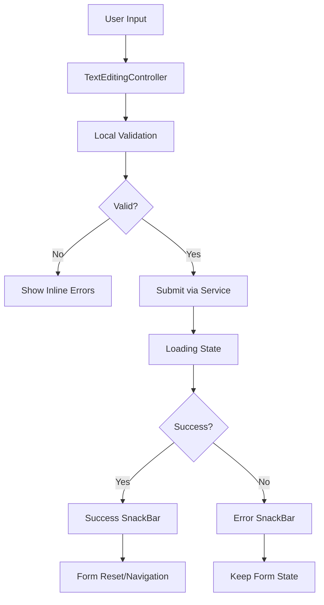

# Forms

This part describe how frontend forms are handled in the project, including libraries used, validation strategies, and state management.

## State Management

- **Flutter StatefulWidget** - Local form state management with `TextEditingController`
- **Form state managed locally** in widget state using controllers and `GlobalKey<FormState>`
- **Form submissions** handled through service layer calls with loading states
- **No persistent form data** - forms reset on navigation/app restart

## Validation

- **Custom `Validators` class** - Static validation methods in `lib/core/utils/validators.dart`
- **Client-side validation patterns**:
  - `isValidEmail()` - regex validation for email format
  - `isValidUrl()` - URI parsing with http/https scheme check
  - `isValidPhoneNumber()` - basic phone format validation
  - `isValidApiToken()` - minimum length validation for API tokens
  - `isNotEmpty()` - null and empty string checks

## Error handling

- **SnackBar notifications** via `FeatureUtils.showErrorSnackBar()`
- **Inline form validation** using Flutter's built-in validator property
- **Success feedback** through `FeatureUtils.showSuccessSnackBar()`
- **Error display** with Material 3 error color scheme

## Form Flow

User fills form → local validation → submit via service layer → show feedback via snackbar → handle success/error states

