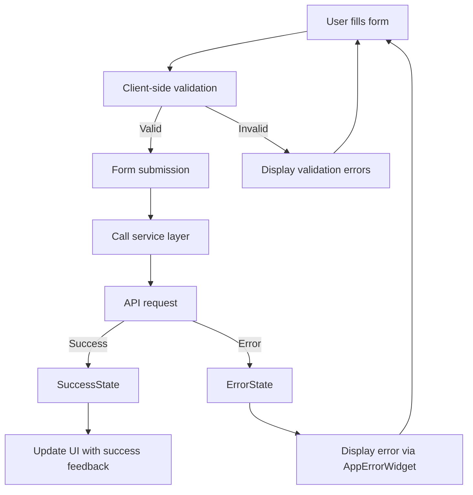

# Forms

This part describe how frontend forms are handled in the project, including libraries used, validation strategies, and state management.

## State Management

- **Flutter built-in state management** - Using `StatefulWidget` and `setState()` for local form state
- **Local form state** - Each form manages its own state using Flutter's standard approaches
- **Form submissions handled via services** - Forms call service layer methods for API communication
- **No persistence** - Form data is not persisted locally, cleared on navigation/reset

## Validation

- **Custom validation utilities** - `lib/core/utils/validators.dart` provides validation functions
- **Client-side validation strategies**:
  - `Validators.isValidEmail()` - Email format validation with regex
  - `Validators.isValidUrl()` - URL format validation for HTTP/HTTPS schemes
  - `Validators.isValidPhoneNumber()` - Basic phone number format validation
  - `Validators.isNotEmpty()` - Non-null and non-empty string validation
  - `Validators.isValidApiToken()` - API token format validation (min 10 chars)

## Error handling

- **Consistent error display** - Using `AppErrorWidget` for standardized error presentation
- **State-based error handling** - `ErrorState` from `FeatureState` hierarchy manages error states
- **Integration test support** - `IntegrationTestHelpers.fillTextField()` for automated form testing

## Form Flow

Form submission follows this pattern: User input → Local validation → Service layer → API call → State update → UI response

