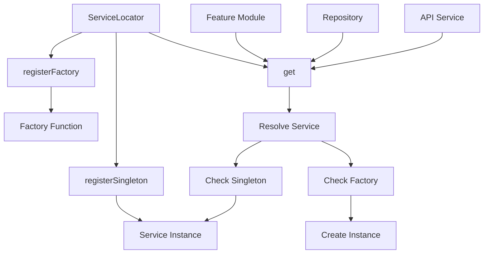
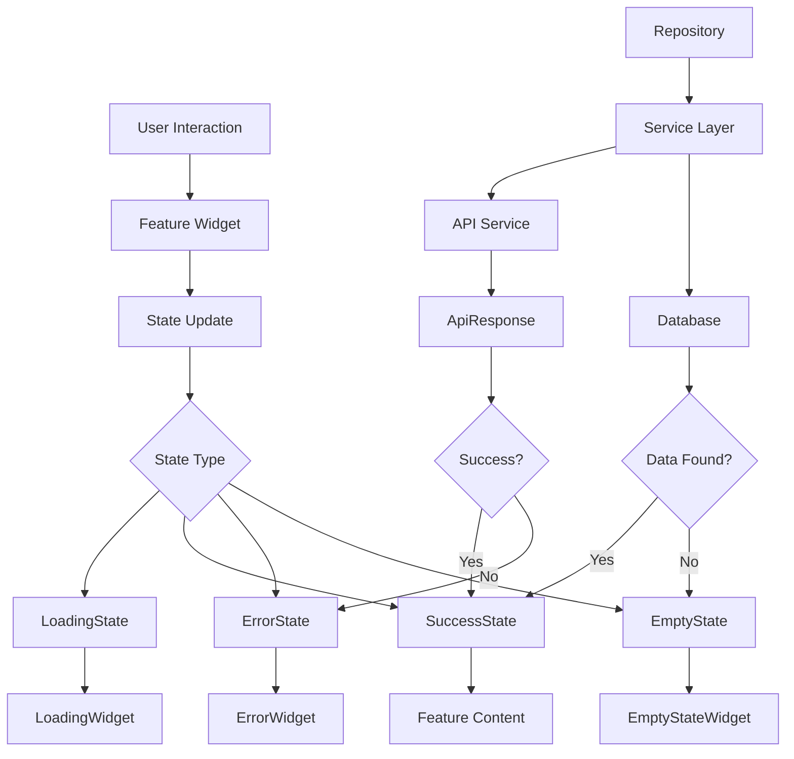
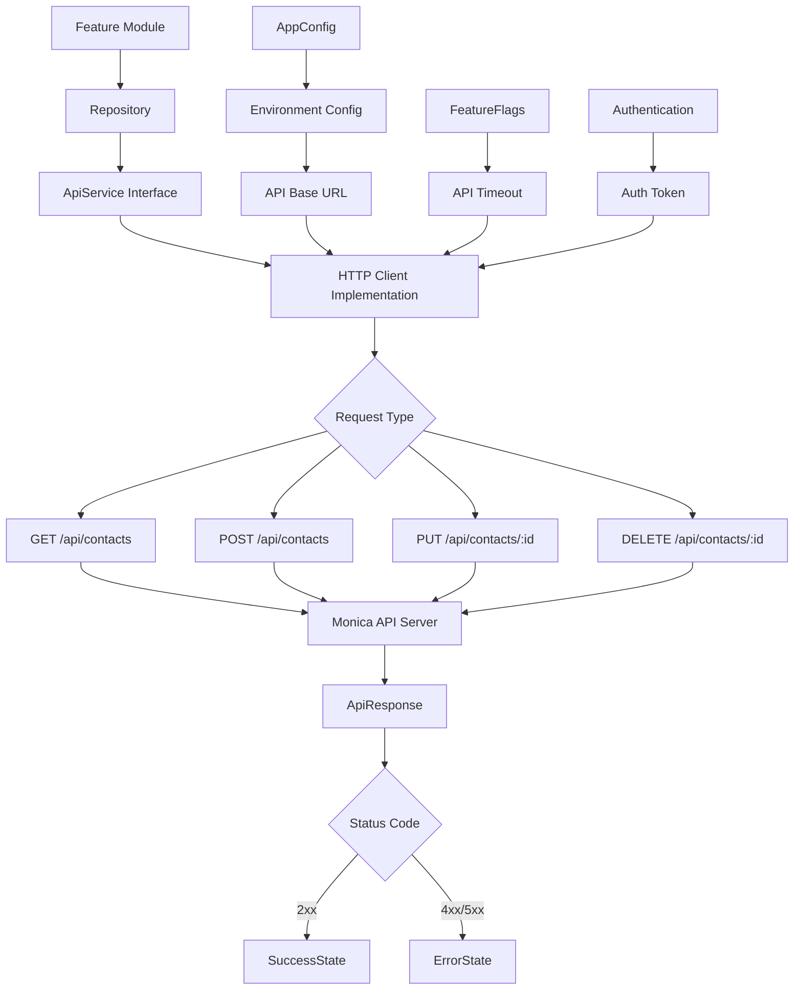

# Architecture

- [Language/Framework](#languageframework)
  - [Mobile](#mobile)
- [Full project structure](#full-project-structure)
  - [Naming Conventions](#naming-conventions)
- [Services communication](#services-communication)
  - [Dependency Injection Flow](#dependency-injection-flow)
  - [State Management Flow](#state-management-flow)
  - [External Services](#external-services)
    - [Monica API](#monica-api)

## Language/Framework

### Mobile

- **Framework**: Flutter → @pubspec.yaml
- **State Management**: Custom state classes with Equatable - Clean architecture pattern
- **Platform**: iOS/Android/Both - Material Design 3
- **Dependency Injection**: Custom ServiceLocator pattern - Singleton and factory registration
- **Error Handling**: Failure classes with typed errors - NetworkFailure, ServerFailure, DatabaseFailure
- **Configuration**: Environment-based config with feature flags
- **Database**: Abstract interface for local storage - Transaction support
- **HTTP Client**: Generic ApiService interface - REST API with ApiResponse wrapper
- **Testing**: flutter_test, integration_test, mocktail → @pubspec.yaml

## Full project structure

Core Flutter project following clean architecture principles with feature-based organization.

```text
lib/
├── main.dart                           # App entry point
├── config/
│   └── feature_flags.dart             # Environment-based feature toggles
├── core/                              # Shared core functionality
│   ├── config/
│   │   ├── app_config.dart            # App-wide configuration
│   │   └── environment.dart           # Environment settings
│   ├── constants/
│   │   └── app_constants.dart         # App constants
│   ├── errors/
│   │   ├── exceptions.dart            # Exception classes
│   │   └── failures.dart              # Failure classes for error handling
│   └── utils/
│       ├── logger.dart                # Logging utility
│       └── validators.dart            # Input validation
├── features/                          # Feature modules
│   ├── calls/                         # Call management feature
│   ├── contacts/                      # Contact management feature
│   ├── settings/                      # App settings feature
│   ├── sync/                          # Data synchronization feature
│   └── shared/                        # Shared feature components
│       ├── models/
│       │   └── feature_state.dart     # Base state classes
│       ├── utils/
│       │   └── feature_utils.dart     # Shared utilities
│       └── widgets/                   # Reusable UI components
│           ├── empty_state_widget.dart
│           ├── error_widget.dart
│           └── loading_widget.dart
├── services/                          # Service layer
│   ├── interfaces/
│   │   ├── api_service.dart           # HTTP API interface
│   │   ├── base_service.dart          # Base service interface
│   │   └── storage_service.dart       # Local storage interface
│   ├── implementations/
│   │   └── base_service_impl.dart     # Base service implementation
│   └── service_locator.dart           # Dependency injection
└── db/                               # Database layer
    ├── interfaces/
    │   ├── database_interface.dart    # Database abstraction
    │   └── repository_interface.dart  # Repository pattern
    ├── models/
    │   └── base_model.dart           # Base model class
    └── repositories/
        └── base_repository.dart      # Base repository implementation
```

### Naming Conventions

- **Files**: snake_case - following Dart conventions
- **Classes**: PascalCase - MonicaApp, FeatureState
- **Functions**: camelCase - build, buildConfigItem
- **Variables**: camelCase - apiBaseUrl, currentEnvironment
- **Constants**: camelCase/UPPER_CASE - AppConfig.appName, Environment.DEVELOPMENT
- **Interfaces**: PascalCase with Interface suffix - DatabaseInterface, ApiService

## Services communication

Internal communication follows clean architecture with dependency injection and state management patterns.

### Dependency Injection Flow



### State Management Flow



### External Services

External service integration through abstract interfaces with environment-specific configuration.

#### Monica API

