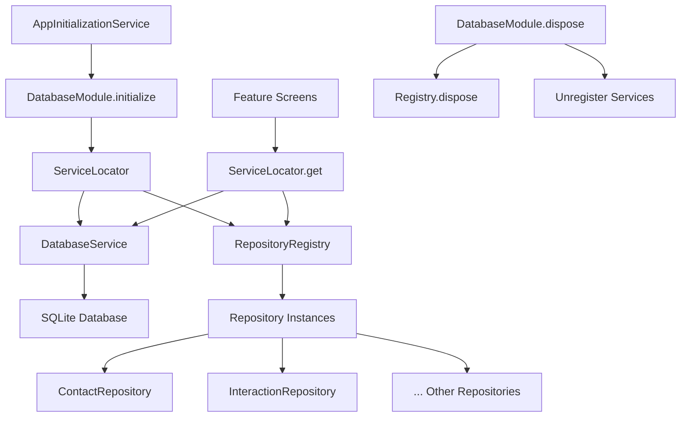
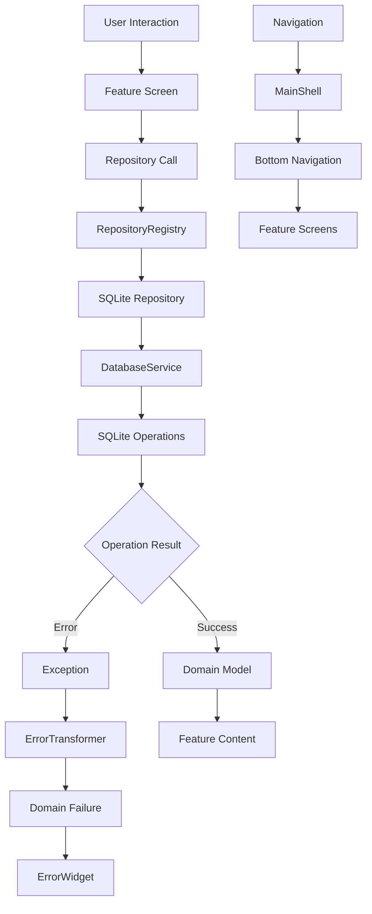
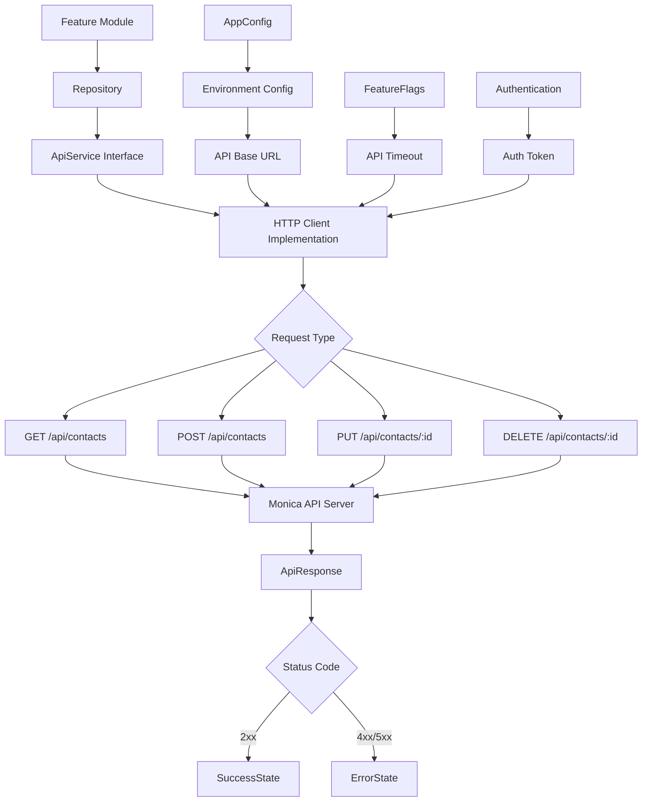

# Architecture

- [Language/Framework](#languageframework)
  - [Mobile](#mobile)
- [Full project structure](#full-project-structure)
  - [Naming Conventions](#naming-conventions)
- [Services communication](#services-communication)
  - [Dependency Injection Flow](#dependency-injection-flow)
  - [State Management Flow](#state-management-flow)
  - [External Services](#external-services)
    - [Monica API](#monica-api)

## Language/Framework

### Mobile

- **Framework**: Flutter → @pubspec.yaml
- **State Management**: Custom state classes with `Equatable` - Clean architecture pattern
- **Platform**: iOS/Android/Both - Material Design 3
- **Dependency Injection**: Custom `ServiceLocator` pattern with `DatabaseModule` - Singleton and factory registration
- **Error Handling**: Comprehensive error transformation with `ErrorTransformer` - Domain-specific failures
- **Configuration**: Environment-based config with feature flags - `EnvironmentConfig`, `AppConfig`
- **Database**: SQLite with repository pattern - `DatabaseService` with migration system
- **HTTP Client**: Prepared `ApiService` interface architecture - Not yet implemented
- **UI Components**: Feature-based navigation with `MainShell` - Bottom navigation system
- **Testing**: `flutter_test`, `integration_test`, `mocktail` → @pubspec.yaml
- **Development Status**: Active development - Navigation, database layer, and feature foundations implemented

## Full project structure

Core Flutter project following clean architecture principles with feature-based organization.

```text
lib/
├── main.dart                           # App entry point with MonicaApp and MainShell navigation
├── config/
│   └── feature_flags.dart             # Environment-based feature toggles
├── core/                              # Shared core functionality
│   ├── config/
│   │   ├── app_config.dart            # App-wide configuration
│   │   └── environment.dart           # Environment settings
│   ├── constants/
│   │   └── app_constants.dart         # App constants
│   ├── di/
│   │   └── database_module.dart       # Database dependency injection module
│   ├── errors/
│   │   ├── exceptions.dart            # Exception classes
│   │   └── failures.dart              # Failure classes for error handling
│   ├── services/
│   │   └── app_initialization_service.dart  # Application startup orchestration
│   └── utils/
│       ├── error_transformer.dart     # Exception-to-failure transformation
│       ├── logger.dart                # Logging utility
│       └── validators.dart            # Input validation
├── features/                          # Feature modules - fully implemented
│   ├── calls/                         # Call management feature
│   │   ├── screens/calls_screen.dart
│   │   └── widgets/call_log_item.dart
│   ├── contacts/                      # Contact management feature
│   │   ├── screens/contacts_screen.dart
│   │   └── widgets/contact_list_item.dart
│   ├── navigation/                    # Navigation shell and components
│   │   ├── screens/main_shell.dart    # Main app shell with bottom navigation
│   │   └── widgets/bottom_navigation_bar.dart
│   ├── settings/                      # App settings feature
│   │   ├── screens/settings_screen.dart
│   │   └── widgets/settings_section.dart
│   ├── shared/                        # Shared feature components
│   │   ├── models/
│   │   │   └── feature_state.dart     # Base state classes with Equatable
│   │   ├── utils/
│   │   │   └── feature_utils.dart     # Shared utilities
│   │   └── widgets/                   # Reusable UI components
│   │       ├── empty_state_widget.dart
│   │       ├── error_widget.dart
│   │       └── loading_widget.dart
│   └── sync/                          # Data synchronization feature
│       ├── screens/sync_screen.dart
│       └── widgets/sync_status_card.dart
├── services/                          # Service layer
│   ├── interfaces/
│   │   ├── api_service.dart           # HTTP API interface (planned)
│   │   ├── base_service.dart          # Base service interface
│   │   └── storage_service.dart       # Local storage interface
│   ├── implementations/
│   │   └── base_service_impl.dart     # Base service implementation
│   └── service_locator.dart           # Custom dependency injection
└── db/                               # Database layer - comprehensive implementation
    ├── database_config.dart           # SQLite schema configuration (legacy)
    ├── database_service.dart          # SQLite database service implementation
    ├── interfaces/                    # Repository interfaces for all entities
    │   ├── activity_repository.dart
    │   ├── contact_repository.dart
    │   ├── database_interface.dart    # Database abstraction
    │   ├── debt_repository.dart
    │   ├── gift_repository.dart
    │   ├── interaction_repository.dart
    │   ├── life_event_repository.dart
    │   ├── note_repository.dart
    │   ├── relationship_repository.dart
    │   ├── reminder_repository.dart
    │   ├── repository_interface.dart  # Base repository pattern
    │   └── task_repository.dart
    ├── migrations/                    # Database migration system
    │   ├── migration_runner.dart      # Migration orchestration with rollback support
    │   └── v1_initial_schema.dart     # Initial schema migration
    ├── models/                        # Domain models with Equatable
    │   ├── activity.dart
    │   ├── base_model.dart           # Base model with common fields
    │   ├── contact.dart
    │   ├── debt.dart
    │   ├── gift.dart
    │   ├── interaction.dart
    │   ├── life_event.dart
    │   ├── note.dart
    │   ├── relationship.dart
    │   ├── reminder.dart
    │   └── task.dart
    └── repositories/                  # SQLite repository implementations
        ├── base_repository.dart      # Base repository with common operations
        ├── repository_registry.dart  # Repository factory and lifecycle management
        ├── sqlite_activity_repository.dart
        ├── sqlite_contact_repository.dart
        ├── sqlite_debt_repository.dart
        ├── sqlite_gift_repository.dart
        ├── sqlite_interaction_repository.dart
        ├── sqlite_life_event_repository.dart
        ├── sqlite_note_repository.dart
        ├── sqlite_relationship_repository.dart
        ├── sqlite_reminder_repository.dart
        └── sqlite_task_repository.dart
```

### Naming Conventions

- **Files**: snake_case - following Dart conventions
- **Classes**: PascalCase - `MonicaApp`, `FeatureState`, `ServiceLocator`
- **Functions**: camelCase - `build`, `registerSingleton`, `get<T>`
- **Variables**: camelCase - `currentEnvironment`, `_monicaBrandColor`
- **Constants**: camelCase/UPPER_CASE - `AppConfig.appName`, `Environment.DEVELOPMENT`
- **Interfaces**: PascalCase with Interface suffix - `DatabaseInterface`, `ApiService`

## Services communication

Internal communication follows clean architecture with dependency injection and state management patterns.

### Dependency Injection Flow



### State Management Flow



### External Services

External service integration through abstract interfaces with environment-specific configuration.

#### Monica API



## Database Architecture

### Repository Pattern Implementation

**Current Architecture:**
- **DatabaseService**: SQLite implementation of `DatabaseInterface` with transaction support
- **RepositoryRegistry**: Factory pattern for lazy-loaded repository instances
- **Repository Hierarchy**: Interface-first design with SQLite implementations
- **Model Layer**: Domain models extending `BaseModel` with `Equatable` support

**Dependency Flow:**
```text
Feature Screen → RepositoryRegistry → SqliteXxxRepository → DatabaseService → SQLite
```

**Key Components:**
- `@lib/db/database_service.dart` - SQLite connection and transaction management
- `@lib/db/repositories/repository_registry.dart` - Repository factory and lifecycle
- `@lib/core/di/database_module.dart` - Database dependency injection
- `@lib/db/migrations/migration_runner.dart` - Schema versioning with rollback support

### Error Handling Strategy

**Comprehensive Error Transformation:**
- **ErrorTransformer**: Converts SQLite exceptions to domain failures
- **Failure Types**: `DatabaseFailure`, `ValidationFailure`, `NetworkFailure`, etc.
- **User-Friendly Messages**: Context-aware error messages for UI display
- **SQLite-Specific Handling**: Constraint violations, foreign key errors, corruption detection

**Error Flow:**
```text
SQLite Exception → ErrorTransformer → Domain Failure → User Message
```

### Database Implementation Guidelines

**Migration System:**
- **MigrationRunner**: Versioned schema migrations with up/down support
- **Rollback Support**: Development-friendly rollback to previous schema versions
- **Transaction Safety**: All migrations run within transactions
- **Schema Versioning**: Tracked in `schema_version` table

**SQLite Configuration:**
- **Essential Pragmas**: `PRAGMA foreign_keys = ON` for data integrity
- **Conservative Approach**: Avoid WAL mode and complex pragmas during development
- **Transaction Management**: Proper handling of nested transactions and deadlock prevention

**Repository Guidelines:**
- **Interface First**: All repositories implement domain interfaces
- **Lazy Loading**: Repository instances created on-demand via registry
- **Base Repository**: Common CRUD operations in `BaseRepository`
- **Type Safety**: Strong typing with domain models and generics

## Feature Architecture

### Navigation System

**Shell-Based Navigation:**
- **MainShell**: Primary app container with bottom navigation
- **Bottom Navigation**: Four main sections - Contacts, Calls, Settings, Sync
- **Screen Organization**: Feature-based screen and widget organization
- **State Management**: Local state management per feature screen

**Feature Structure:**
```text
features/[feature_name]/
├── screens/[feature_name]_screen.dart
└── widgets/[feature_name]_widgets.dart
```

**Implemented Features:**
- **Contacts**: Contact management and display
- **Calls**: Call history and management
- **Settings**: Application configuration
- **Sync**: Data synchronization status and controls
- **Navigation**: Shell and navigation components
- **Shared**: Common widgets and utilities

### Application Initialization

**Startup Flow:**
1. **main()**: Flutter binding initialization
2. **AppInitializationService**: Orchestrates app startup
3. **DatabaseModule**: Database and repository setup
4. **ServiceLocator**: Dependency registration
5. **MainShell**: Navigation shell rendering

**Key Files:**
- `@lib/main.dart` - App entry point and MaterialApp setup
- `@lib/core/services/app_initialization_service.dart` - Startup orchestration
- `@lib/features/navigation/screens/main_shell.dart` - Navigation shell
- `@lib/core/di/database_module.dart` - Database initialization