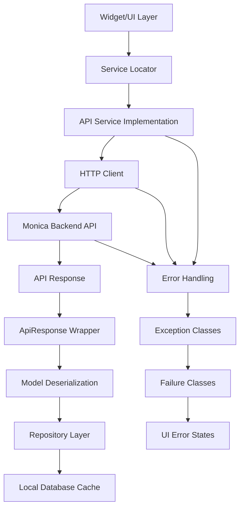

# Communication between backend and frontend

This part describes how the frontend communicates with backend services, including the services used, types of requests, and main entities involved.

## Overview

The Monica Mobile App follows clean architecture principles with well-defined interfaces for backend communication. The current implementation provides architectural foundation but concrete HTTP client implementation is not yet present.

- **Services**: `ApiService` interface, `BaseService` pattern, service locator dependency injection
- **Request Types**: GET, POST, PUT, DELETE, PATCH operations defined in `ApiService`
- **Entities**: `BaseModel` abstract class in `lib/db/models/`, `ApiResponse<T>` wrapper
- **Data Flow**: Service -> Repository -> Model pattern with clean separation
- **Error Handling**: Comprehensive exception and failure classes for network, server, auth errors
- **Validation**: Exception-based validation with `ValidationException` and `ValidationFailure`

### Data Flow

When a new entity is created on the frontend, the following flow is typically followed to reach backend:

## Current Implementation Status

### Interfaces Defined
- `ApiService` abstract class with HTTP method signatures
- `BaseService` lifecycle management (initialize, dispose, ensureInitialized)
- `ApiResponse<T>` generic wrapper for HTTP responses
- `BaseModel` abstract class for entity serialization

### Error Architecture
- **Exceptions**: `NetworkException`, `ServerException`, `AuthenticationException`, `ValidationException`
- **Failures**: `NetworkFailure`, `ServerFailure`, `AuthenticationFailure`, `ValidationFailure`
- **Response Handling**: Status code validation in `ApiResponse.isSuccess`

### Missing Implementation
- Concrete HTTP client (no `dio` or `http` dependency)
- API service implementation
- Authentication token management
- Request/response interceptors
- Caching strategies
- Base URL configuration

## Future Implementation Requirements

### HTTP Client Setup
- Add `dio` package for HTTP requests
- Implement `ApiServiceImpl` extending `BaseServiceImpl`
- Configure interceptors for logging, auth, error handling

### Authentication Flow
- Token storage using `SharedPreferences` or secure storage
- Automatic token refresh mechanism
- Auth state management with service locator

### Data Models
- JSON serialization with `json_annotation` (already added)
- Model generation with `build_runner` (already added)
- API response DTOs and domain models separation

### Caching Strategy
- Local database integration with existing repository pattern
- Cache invalidation policies
- Offline-first data synchronization

### Endpoints Structure
- Base URL configuration via environment
- API versioning support
- RESTful endpoint conventions for Monica API

## Key Files

- `/lib/services/interfaces/api_service.dart` - API service contract
- `/lib/services/implementations/base_service_impl.dart` - Base service implementation
- `/lib/core/errors/exceptions.dart` - Exception classes
- `/lib/core/errors/failures.dart` - Failure classes
- `/lib/db/models/base_model.dart` - Base entity model
- `/lib/services/service_locator.dart` - Dependency injection

## Dependencies

### Current
- `equatable` - Value equality for models and failures
- `json_annotation` - JSON serialization annotations
- `json_serializable` - Code generation for JSON

### Required for Implementation
- `dio` - HTTP client library
- `shared_preferences` - Local storage for tokens
- `flutter_secure_storage` - Secure token storage
- `connectivity_plus` - Network status monitoring