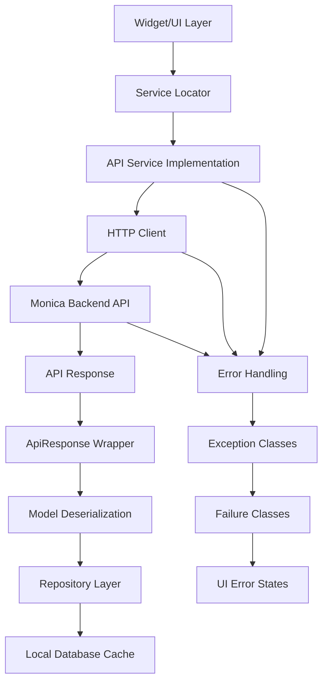

# Communication between backend and frontend

This part describes how the frontend communicates with backend services, including the services used, types of requests, and main entities involved.

## Overview

The Monica Mobile App follows clean architecture principles with well-defined interfaces for backend communication. The current implementation provides comprehensive architectural foundation with interfaces, error handling, and dependency injection, but concrete HTTP client implementation is not yet present.

- **Services**: `ApiService` interface, `BaseService` pattern, service locator dependency injection
- **Request Types**: GET, POST, PUT, DELETE, PATCH operations defined in `ApiService`
- **Entities**: `BaseModel` abstract class in `lib/db/models/`, `ApiResponse<T>` wrapper
- **Data Flow**: Service -> Repository -> Model pattern with clean separation
- **Error Handling**: Comprehensive exception and failure classes for network, server, auth errors
- **Authentication**: Token management interfaces defined, storage service ready
- **Environment Config**: Multi-environment API URL configuration ready

### Data Flow

When a new entity is created on the frontend, the following flow is typically followed to reach backend:

## Current Implementation Status

### ✅ Implemented Architecture
- **Service Interfaces**: Complete `ApiService` abstract class with HTTP method signatures
- **Service Management**: `BaseService` and `BaseServiceImpl` with lifecycle management (initialize, dispose, ensureInitialized)
- **Response Wrapper**: `ApiResponse<T>` generic wrapper for HTTP responses with success validation
- **Data Models**: `BaseModel` abstract class for entity serialization with `toMap()`/`fromMap()` methods
- **Service Locator**: Full dependency injection system with singleton and factory patterns
- **Environment Config**: Multi-environment setup with development/staging/production API URLs
- **Storage Interface**: `StorageService` for local key-value storage (authentication tokens, etc.)

### ✅ Error Architecture
- **Exceptions**: Complete hierarchy with `NetworkException`, `ServerException`, `AuthenticationException`, `ValidationException`, `CacheException`, `PermissionException`
- **Failures**: Clean architecture failure classes with `NetworkFailure`, `ServerFailure`, `AuthenticationFailure`, `ValidationFailure`, etc.
- **Response Handling**: Status code validation in `ApiResponse.isSuccess` (200-299 range)
- **Exception Handling**: Consistent error propagation with error codes and messages

### ✅ Testing Infrastructure
- **Mock Services**: Complete mock implementations for `ApiService`, `StorageService` using mocktail
- **Mock Response**: `MockApiResponse<T>` for testing API responses
- **Service Registration**: TestHelper utilities for service locator setup

### 🔄 In Progress - Sync Feature
- **Sync Screen**: Basic UI with sync status display and manual refresh button (placeholder)
- **Sync Status Widget**: Network status indicator with online/offline states and pending changes count
- **Sync Architecture**: UI layer ready for integration with actual sync service

### ❌ Missing Implementation
- **HTTP Client**: No concrete implementation (no `dio` or `http` dependency in pubspec.yaml)
- **API Service Implementation**: No concrete `ApiServiceImpl` extending `BaseServiceImpl`
- **Authentication Flow**: Token storage and refresh mechanisms not implemented
- **Request/Response Interceptors**: No network middleware for logging, auth, error handling
- **Caching Strategies**: No offline-first data synchronization
- **Storage Implementation**: No concrete `StorageService` implementation

## Future Implementation Requirements

### HTTP Client Setup
- Add `dio` package for HTTP requests
- Implement `ApiServiceImpl` extending `BaseServiceImpl`
- Configure interceptors for logging, auth, error handling

### Authentication Flow
- Token storage using `SharedPreferences` or secure storage
- Automatic token refresh mechanism
- Auth state management with service locator

### Data Models
- JSON serialization with `json_annotation` (already added)
- Model generation with `build_runner` (already added)
- API response DTOs and domain models separation

### Caching Strategy
- Local database integration with existing repository pattern
- Cache invalidation policies
- Offline-first data synchronization

### Endpoints Structure
- Base URL configuration via environment
- API versioning support
- RESTful endpoint conventions for Monica API

## Key Files

### Service Layer
- `/lib/services/interfaces/api_service.dart` - API service contract with HTTP methods and `ApiResponse<T>`
- `/lib/services/interfaces/base_service.dart` - Base service interface with lifecycle methods
- `/lib/services/interfaces/storage_service.dart` - Local storage interface for key-value data
- `/lib/services/implementations/base_service_impl.dart` - Base service implementation with logging
- `/lib/services/service_locator.dart` - Dependency injection with singleton/factory patterns

### Error Handling
- `/lib/core/errors/exceptions.dart` - Exception hierarchy (Network, Server, Auth, Validation, etc.)
- `/lib/core/errors/failures.dart` - Clean architecture failure classes with Equatable

### Configuration
- `/lib/core/config/environment.dart` - Multi-environment API URL configuration
- `/lib/core/services/app_initialization_service.dart` - Application initialization service

### Data Models
- `/lib/db/models/base_model.dart` - Base entity model with `toMap()`/`fromMap()` serialization
- `/lib/db/models/contact.dart` - Example model implementation with full serialization

### Sync Feature (UI Only)
- `/lib/features/sync/screens/sync_screen.dart` - Sync management UI with manual refresh
- `/lib/features/sync/widgets/sync_status_card.dart` - Network status and sync state display

### Testing Support
- `/test/mocks/mock_services.dart` - Mock implementations for all service interfaces

## Dependencies

### Current (in pubspec.yaml)
- `equatable: ^2.0.5` - Value equality for models and failures (✅ Used in BaseModel and Failure classes)
- `json_annotation: ^4.8.1` - JSON serialization annotations (🔄 Available for future use)
- `json_serializable: ^6.7.1` - Code generation for JSON (🔄 Available with build_runner)
- `mocktail: ^1.0.0` - Testing mocks (✅ Used in mock_services.dart)

### Required for Full Implementation
- `dio` - HTTP client library with interceptors and error handling
- `shared_preferences` - Local storage for authentication tokens and user preferences
- `flutter_secure_storage` - Secure storage for sensitive authentication data
- `connectivity_plus` - Network status monitoring for offline/online state detection
- `logger` - Structured logging for HTTP requests and responses

## Implementation Roadmap

### Phase 1: Core HTTP Client
1. Add `dio` dependency and create `DioApiService` implementing `ApiService`
2. Implement request/response interceptors for logging and error handling
3. Create `SharedPreferencesStorageService` implementing `StorageService`
4. Configure environment-based API base URLs

### Phase 2: Authentication
1. Implement token storage and retrieval using `StorageService`
2. Create authentication interceptor for automatic token attachment
3. Implement token refresh mechanism with retry logic
4. Add authentication state management

### Phase 3: Sync Implementation
1. Create concrete sync service with conflict resolution
2. Implement offline-first data synchronization
3. Add connectivity monitoring and automatic retry
4. Connect sync UI to actual sync service implementation

### Phase 4: Advanced Features
1. Implement request/response caching strategies
2. Add upload/download progress tracking
3. Implement background sync with WorkManager
4. Add API versioning and backward compatibility